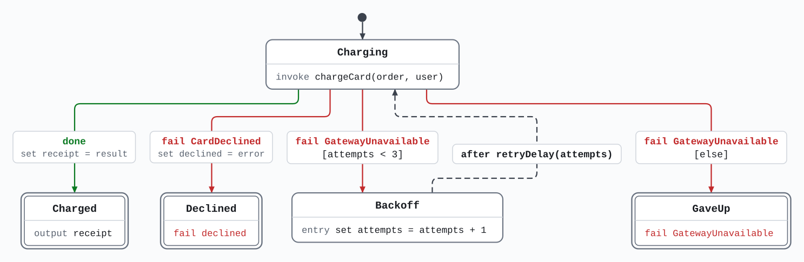

# Roadbook: a statechart language with Rust and Effect runtimes

Roadbook is a proposal for a state machine library in the spirit of xstate, built so that a program's flow lives in a file a person can read, check and see as a diagram, while the code an agent writes is confined to small typed functions that the flow calls.

## The proposal

Program flow is written in a small language, in `.road` files. A compiler checks it and produces one JSON document, the IR. Everything else reads the IR:

```
                         ┌─▶ TypeScript code generator ─▶ typed handle for Effect v4
 *.road ─▶ compiler ─▶ IR ├─▶ Rust macro                ─▶ types and a trait to implement
          (checks)       ├─▶ viewer                    ─▶ self-contained HTML diagram
                         └─▶ both runtimes interpret it
```

Four properties follow from this shape.

1. **The diagram is the program.** The viewer draws the same IR the runtimes execute, so the picture cannot be out of date. No agent is involved in producing it.
2. **One definition, two languages.** A chart is not Rust or TypeScript. Each runtime gets generated types and a list of functions to implement.
3. **The chart shows data as well as control.** Charts declare types and pass explicit arguments. Host functions see only what the chart hands them, so there is no hidden reading or writing of shared state.
4. **Validation is compilation.** Unknown targets, unhandled errors, unreachable branches and reads of unassigned variables are compile errors with a file and line, in a form agents can act on.

## What it looks like

A chart, from [`examples/shop/checkout.road`](../../examples/shop/checkout.road):

```
/// Charge the customer's card, retrying while the payment gateway is down.
machine Checkout(order: Order, user: User) -> Receipt ! CardDeclined | GatewayUnavailable {
  var attempts: int = 0
  var receipt:  Receipt
  var declined: CardDeclined

  initial Charging

  state Charging {
    invoke chargeCard(order, user) {
      done                    -> Charged   set receipt = result
      fail CardDeclined       -> Declined  set declined = error
      fail GatewayUnavailable {
        if attempts < 3       -> Backoff
        else                  -> GaveUp
      }
    }
  }

  state Backoff {
    entry set attempts = attempts + 1
    after retryDelay(attempts) -> Charging
  }

  final state Charged  { output receipt }
  final state Declined { fail declined }
  final state GaveUp   { fail GatewayUnavailable }
}
```

The diagram `roadbook viz` draws from it:



The code that implements it, in TypeScript with Effect v4:

```ts
export const CheckoutLive = Checkout.implement({
  fns:   { retryDelay: ({ attempt }) => Duration.millis(200 * 2 ** attempt) },
  tasks: { chargeCard: ({ order, user }) => Payments.use((p) => p.charge(order, user)) }
})

CheckoutLive.run({ order, user })   // Effect<Receipt, CardDeclined | GatewayUnavailable, Payments>
```

and in Rust:

```rust
impl checkout::Handlers for App {
    fn retry_delay(&self, attempt: i64) -> Duration {
        Duration::from_millis(200 * 2u64.pow(attempt as u32))
    }
    async fn charge_card(&self, order: &Order, user: &User) -> Result<Receipt, ChargeCardError> {
        self.payments.charge(order, user).await
    }
}

checkout::run(&app, order, user).await   // Result<Receipt, CheckoutError>
```

A machine has the signature of a task, so a larger machine invokes `Checkout` exactly as it would invoke a single function. [`place_order.road`](../../examples/shop/place_order.road) does this to handle an HTTP request end to end, and is the Express example from the task description.

## Decisions

These are the choices that shape the rest. Each has a recommendation, which the rest of the design assumes.

**Status, 26 November 2026:** the recommendations are accepted. Machines are written in the custom `.road` language, and messaging between machines stays at milestone 5, after the two runtimes.

| Decision | Recommendation | Main alternative | Discussed in |
| --- | --- | --- | --- |
| How machines are written | A custom language compiled to a JSON IR | YAML with a schema, producing the same IR | [Alternatives](alternatives.md#how-machines-are-written) |
| How much is in the chart | Types, explicit arguments and a small expression language. Logic stays in host functions. | Names only, with host code receiving the whole context as in xstate | [Alternatives](alternatives.md#what-is-declared-and-what-is-implemented) |
| Semantics | SCXML's, as xstate uses, with work strictly tied to states | Something simpler and flat | [Semantics](semantics.md#execution-model) |
| Compiler implementation | Once, in Rust, shipped natively and as WebAssembly on npm | In TypeScript | [Alternatives](alternatives.md#where-the-compiler-lives) |
| Runtime implementation | A pure core written natively in each language, held together by a shared conformance suite | One Rust core compiled to WebAssembly | [Semantics](semantics.md#a-pure-core-and-a-driver) |
| Machines talking to each other | Declared and typed: `send`, `emit` and `ref` parameters in the chart. No global actor registry. | xstate's model, where any actor can hold a reference to any other | [Actors and messaging](actors.md) |
| Typed host code | Generated: a committed `.road.ts` file for TypeScript, a macro for Rust | Type inference from code-first definitions | [TypeScript](typescript.md), [Rust](rust.md) |
| Diagram layout | ELK in the browser, with the same drawing code producing static SVG | Mermaid or Graphviz only | [Visualization](visualization.md#layout) |
| Build order | Language, then viewer, then TypeScript runtime, then Rust runtime | Rust runtime first | [Roadmap](roadmap.md#milestones) |

The first is the one that most needs agreement, because it is the most expensive to reverse. It is cheaper to reverse than it looks: a YAML front end could produce the same IR without touching anything downstream.

## What has been checked

This is a design, with a few pieces built to test its riskiest claims.

| Claim | Evidence | Where |
| --- | --- | --- |
| The language can be parsed and checked. | A throwaway compiler in JavaScript parses the three example files, resolves imports and targets, and reports errors with locations. Writing it exposed about a dozen gaps in the first grammar, which are now fixed in the language page. | `spike/compile.mjs`, since replaced by [`crates/roadbook-compiler`](../../crates/roadbook-compiler) |
| A readable diagram can be produced from the IR with no manual layout. | A viewer that renders nested states, invokes, guards and effects for both example machines, interactive and static, checked in a browser. What it showed, and what the real viewer does about it, is on the visualization page. | `spike/viewer`, since replaced by [`packages/viewer`](../../packages/viewer) and `roadbook viz` |
| The TypeScript API's types work with Effect v4: exact inferred error and requirement types, and compile errors for missing, extra or wrongly typed implementations. | A type-level sketch that passes `tsc` against `effect@4.1.5`. | [`spike/api-ts`](../../spike/api-ts) |
| The Rust API's shapes compile, including `Send` futures and one struct implementing several charts' handlers. | A hand-expanded sketch passed `cargo check`; `roadbook::include!` now generates that code, and tests check the `Send` futures, one struct implementing several charts' handlers, and that a chart error or a missing handler method is a compile error. | `spike/api-rust`, since replaced by [`crates/roadbook-macros`](../../crates/roadbook-macros) and [`crates/roadbook`](../../crates/roadbook) |
| The Rust macro can find a chart that another crate ships, and refer to that crate's types. | A stand-in macro tried four mechanisms against path, git, vendored and registry dependencies and a downstream crate. Only a hidden macro exported by the owning crate worked everywhere; renamed dependencies need an alias. | [`spike/cross-crate`](../../spike/cross-crate) |

The Rust runtime ([`crates/roadbook-core`](../../crates/roadbook-core), [`crates/roadbook`](../../crates/roadbook)) passes every conformance case byte for byte, and serves the shop example from axum ([`examples/shop/axum`](../../examples/shop/axum)). Everything on the actors and messaging page is specified on paper only.

## Pages

- [Language](language.md): the syntax, what the compiler checks, and the grammar.
- [Semantics, the IR and the trace](semantics.md): how machines execute, and how two runtimes are kept identical.
- [TypeScript runtime](typescript.md): the Effect v4 API.
- [Rust runtime](rust.md): the Rust API.
- [Actors and messaging](actors.md): machines talking to each other, including across crates.
- [Visualization](visualization.md): the viewer and its modes.
- [Alternatives considered](alternatives.md): formats, existing libraries, and what was rejected.
- [Roadmap](roadmap.md): repository layout, milestones, risks and open questions.
