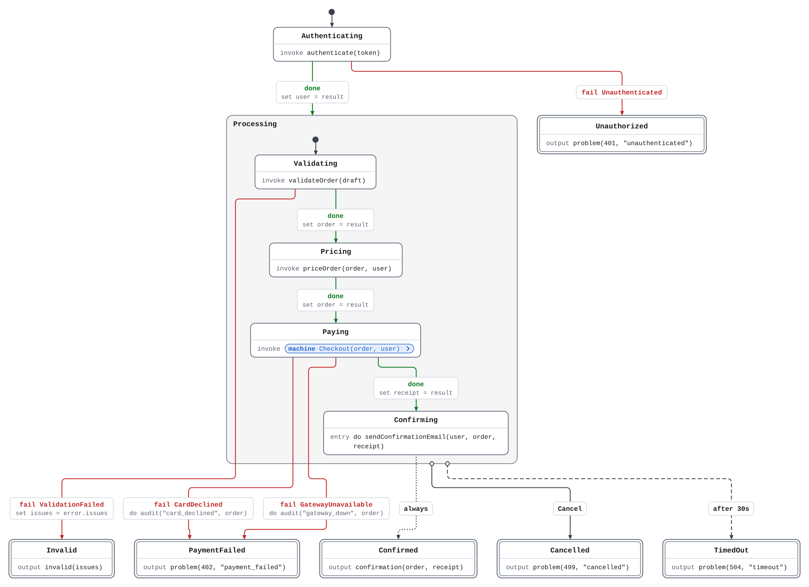
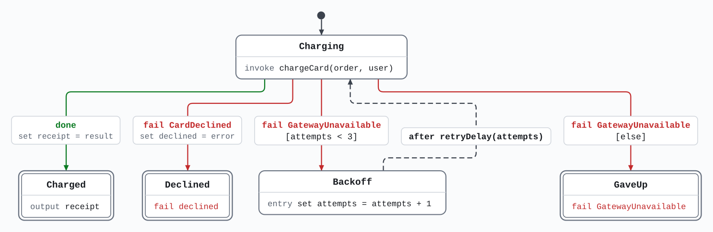

# Visualization

`roadbook viz` turns charts into HTML with no agent and no service involved. It is a deterministic function of the IR: the same chart always gives the same page.

The viewer is [`packages/viewer`](../../packages/viewer) (`@dire-kiwi/roadbook-viewer`), built to one script that the CLI embeds: `crates/roadbook-cli/assets/roadbook-viewer.js` is committed, so building the CLI needs no Node. The bundle includes `@dire-kiwi/roadbook-core`, which simulate mode runs. After changing `packages/viewer` or `packages/core`, rebuild it with `pnpm --filter @dire-kiwi/roadbook-viewer build` and commit it; `pnpm test` and `cargo test` fail while it is stale (`cargo test` reads its header: the hash of the sources of both packages, the elkjs and esbuild versions in `pnpm-lock.yaml`, and the hash of the script, so a dependency bump or a hand edit is caught without Node). `roadbook viz examples/shop` draws the shop example; `roadbook viz examples/shop --trace spec/conformance/cases/place-order-checkout/trace.jsonl` adds a trace to replay.



## What it produces

One HTML page per entry chart, plus `index.html` for the project, in `roadbook-viz/` unless `-o` says otherwise. An entry chart is a file given (or found under a directory given, or in the project) that no other of those files imports; its page draws every machine of its compilation. Each page holds its IR. The viewer script, with the layout engine and the styles, is about 1.5 MB, almost all of it `elkjs`, so the pages of one directory share one copy, `roadbook-viewer.js`, loaded by a plain `<script src>` that also works from `file://`. With `--self-contained` every page inlines the script instead and is one file that works alone. Either way there are no network requests and no server, so the pages open from disk, attach to a pull request as a build artifact, and can be published as a static site from CI.

The index lists every machine in the project and draws which machine invokes which and which talk to which. This is the "big state machine that delegates to more specific ones" view: start at the top-level machine and click down. Because a machine can only reach another through an invoke or a `ref` it is given ([actors and messaging](actors.md)), the charts alone say who can talk to whom, and the index draws all of it, laid out by ELK with the labels as edge labels:

| Edge | Drawn as |
| --- | --- |
| A invokes B | A solid arrow from A to B, unlabelled |
| A holds a `ref B` (a parameter or variable, or an alias of one) | A dashed arrow from A to B labelled `ref inventory`, the names holding it |
| A sends B events | An arrow in the message colour with an open head, from A to B, labelled `sends Release` |
| A calls B (`invoke inventory.reserve(…)` in A) | An arrow in the message colour with a filled head, from A to B, labelled `calls reserve` |
| B emits events A handles (`on b.Event` in A) | A dotted arrow in the message colour with an open head, from B to A, labelled `emits Progress` |

A legend under the graph says the same, and the table of machines has a "Talks to" column with each relation in words (`ref Inventory (inventory)`, `sends Release to Inventory`, `calls reserve on Inventory`, `handles Progress from Upload`). An emitted event no chart handles draws no edge, since only host code could be listening. A machine of another package is named by its package and its path in it, `inventory/inventory.road:18`, as imports write it.

## Reading a diagram

| Element | Drawn as |
| --- | --- |
| State | A rounded box with its name |
| Compound state | A container with its children laid out inside |
| Initial state | A filled dot with an arrow |
| Final state | A double border, with its `output` or `fail` |
| `invoke` of a task | A row inside the state: `invoke chargeCard(order, user)` |
| `invoke` of a machine | The same row with a badge. Clicking it opens that machine. |
| `invoke … as upload` | The badge ends with `as upload`, the name in italics |
| `ref Machine` parameter or variable | In the signature above the diagram and in the details panel, a link that opens that machine |
| `send upload.Pause { … }`, `emit Progress { … }` | In an edge label or a state's row, an effect line like the others, in the message colour with the keyword in bold. Clicking it opens the event in the machine that declares it: the receiver's for a `send`, the machine's own for an `emit`. |
| `invoke inventory.reserve(…)`, a call | The invoke row, the call in the message colour. Clicking it opens the call in the callee's machine. |
| `reply pending done v`, `reply call fail OutOfStock { … }` | An effect line in the message colour with `reply` in bold. Clicking it opens the call it answers. |
| `entry`, `exit`, internal transitions | Rows inside the state |
| Collapsed compound state | A box with `+`, a bar under it and the row `12 states inside (collapsed)` |
| Transition on an event | A solid arrow labelled with the event (`on *` for any event) |
| Transition on an event another machine emitted (`on upload.Progress`) | A solid arrow in the message colour, labelled through the sender: `upload.Progress`. Clicking the name opens the event in the sender's machine. As a row inside a state, `on upload.Progress` with the name in the message colour. |
| Transition on a call another run made (`on reserve`) | The same arrow, labelled with the call: `reserve`. Clicking the name opens the call. As a row inside a state, `on reserve`. |
| Transition from a state hidden in a collapsed one | The same arrow, leaving the collapsed box from a small square |
| `done` outcome | A solid arrow labelled `done` |
| `fail` outcome | An arrow in the error colour labelled `fail CardDeclined` |
| `after` | A dashed arrow labelled with the delay |
| `always` | A dotted arrow |
| Guard | `[attempts < 3]` after the trigger |
| Effects | `set`, `do`, `send`, `emit` and `reply` lines under the label, in a quieter style, one per line (also in a state's rows) |

Every distinction is made in text or line style as well as colour, so the diagram reads in greyscale and for colour-blind readers.

Transitions written on a compound state leave from the container's border, which is how a reader sees at a glance that `Cancel` and the 30 second budget apply to every step inside `Processing`.



## Layout

Layout is done by ELK's layered algorithm (through `elkjs`), which is the established choice for statecharts because it handles nested containers and edges that cross between levels. It runs in the browser when the page loads and again when a state is collapsed or expanded. Transition labels are ELK edge labels placed on their own edge, so a label is never ambiguous about which arrow it belongs to.

The drawing code is a pure function from the IR and a computed layout to SVG. The same function runs in Node to produce static, script-free SVG for places that cannot run scripts, such as a README or an email (`packages/viewer/scripts/svg.ts`; the pictures on this page are its output, with text widths estimated rather than measured).

### What the spike showed, and what the viewer does about it

The viewer's tests lay out every example, every conformance chart and a stress chart (parallel regions, self-loops, deep nesting, many finals), opened and fully expanded, and check that no two state boxes overlap and no label overlaps a state or another label.

- **Width with many final states.** ELK put `PlaceOrder`'s six finals in one row, about 1450 units wide. The viewer adds invisible edges between the final states of a container, three to a row, so they stack: `PlaceOrder` is now about 1220 by 1220.
- **A return edge's label far from its source.** ELK's feedback-edge routing took `after retryDelay(attempts)` around the outside of `Checkout`. Without it, and with `centerLabelPlacementStrategy: TAIL_LAYER`, the label sits between `Backoff` and `Charging`, next to `Backoff`.
- **The ELK option that crashed `elkjs`.** Model order (`considerModelOrder`) crashed 0.11.1 in nested graphs; 0.12 refuses it there with an `UnsupportedConfigurationException`. The viewer sets it on the root graph only, and falls back to plain layered, then to ELK's layered defaults, if ELK throws; the tests force both fallbacks.
- **1.6 MB per file.** Pages share one copy of the script, as above; only `--self-contained` repeats it.
- **Large charts.** A machine with more than 32 states opens with the containers at its deepest levels collapsed, as few levels as bring it to 32 drawn states. The 46-state `examples/large` opens with seven collapsed.

## Interaction

- Pan (drag), zoom (wheel, `+`, `-`) and fit to view (`f`). A chart too large to read whole opens at its top at a readable size.
- Collapse and expand compound states with the `+`/`-` box in their title, a double click or the details panel; the layout is redone. Large charts open with deep levels collapsed; "Expand all" undoes it.
- Click a state or a transition for its details: doc comment, the invoked task's full signature, guard, effects, and the source location as `file:line`.
- Click a machine invoke to open the child machine, with a trail back.
- The machine's details list the events it accepts, the events it emits and the calls it answers (`reserve(orderId: string, items: Item[]) ! OutOfStock`), which machines it talks to (invokes, holds a `ref` to, sends which events to, calls, handles which emitted events from) and which machines of the chart talk to it.
- Click a `send`, an `emit` or the name in an `on upload.Progress` label to open the event in the machine that declares it: its declaration and fields, where that machine handles or emits it, and every place in the chart that sends it or handles it, each a link. The transitions it triggers are highlighted. A `ref` type in a signature opens its machine.
- Click a call invoke, an `on reserve` or a `reply` to open the call in the machine that answers it: its signature (it fails with `Unanswered` too, besides its declared errors), the transitions that take it, every `reply` that answers it, and every call invoke in the chart that makes it. A call invoke's details say which `ref` it asks, and its `fail Unanswered` outcome when the callee was not running, dropped the call or ended before replying.
- Search (`/`) by state, event (declared, sent, emitted or handled), call (declared, made, taken or replied to), task, machine, error or action name. Matches are highlighted; choosing one opens its machine, expands what hides it and selects it.
- Light and dark themes, following the system, with a toggle that is remembered.
- A mode switch in the header: Explore (the default), Simulate, Replay and Coverage; a diff page has Diff only ([modes](#modes)). In simulate and replay, `→` (or `n`) steps forward and `←` (or `p`) steps back; in replay `Home` and `End` go to the first and last record.

## Modes

Explore, simulate, replay, diff and coverage are built. The modes other than explore keep the diagram and its interaction and put their own section at the top of the details panel (the details of a state or transition clicked follow below it). Simulate and replay light up the diagram the same way, and as everywhere else every distinction reads in greyscale:

| What | Drawn as |
| --- | --- |
| An active state | A solid ring around its box, a heavier border and a bold name (in the "live" colour); the innermost one inside a collapsed state lights up the collapsed box |
| The states the current record names (replay) | A dashed ring, further out |
| The transitions taken (simulate: by the last choice; replay: the record's, or the run's last) | A heavy line, and a heavy border and an underlined bold trigger on its label (or its row) |

A line over the diagram says where the mode is in words (`Simulate · step 3/5 · t = 30 ms · running · in Processing.Paying`, `Replay · record 22/50 · run r1 · t = 30 · set order = …`), and the panel lists the active states, the last transition and the variables, so nothing depends on seeing the colours.

**Explore.** The static chart, as above.

**Simulate.** Step through the machine on screen by hand. This runs `@dire-kiwi/roadbook-core` in the page (`packages/viewer/src/sim.ts` is a small driver for one run on a virtual clock), so it behaves exactly as the real runtime would; the tests drive it through a conformance case's script and get the case's trace byte for byte (twenty-one cases, the seven of parallel states among them: every one that runs a single machine, with no child run from the chart, no other top-level run, no `together` and no saving or restoring, which the page does not offer).

- **Input.** The machine starts from a JSON form prefilled from its parameter types (empty strings, zeros, `false`, the first enum variant, empty lists, `null` for optionals, records field by field). It is checked as it is typed, with the path to each problem (`input.draft.items[0].qty: expected an integer`), and Start stays disabled until it is well formed. Every value form below works the same way.
- **What can happen next.** The panel lists what the current configuration waits for. Every declared event can be sent (with a form for its fields), and one no active state has an `on` for is marked as one that would be dropped. Each running invoke can end with `done` (a form for its result type), with each of its declared errors (with their fields), or with a host defect. Each running timer can fire, which moves the clock to when it is due. The clock can be advanced by any number of milliseconds, firing the timers due on the way one at a time, earliest first, as a conformance runner's `advance` does. The run can be cancelled from outside.
- **Functions.** When a guard, an effect, a delay or an output calls a host function, the core stops and the panel asks: `retryDelay(1) → duration. What does it return?`, with a form for the return type, a button to make it throw (a host defect), and one to give up the choice. The step is then run again from the same snapshot (the core is pure), asking for the next call it needs, if any. Answers are remembered per argument list, listed in the panel, and can be forgotten; they are kept when the reader steps back or starts again with a new input.
- **Child machines** invoked with a chart in the same IR are treated as tasks: the child run is not started and the reader gives its outcome by hand, as for a task. The panel says so under the invoke, and points to the child's tab to simulate it on its own. A child invoked with `as` can be made to emit one of its events to the run.
- **Messaging.** `send` and `emit` effects are carried out as their records only (`sent`, `emitted`, `undelivered`): there is no other run to deliver to. Actions do nothing.
- **Calls.** A call invoke (`invoke inventory.reserve(…)`) is answered by hand like a task: done with a value of the call's result type, one of its declared errors, or the built-in `Unanswered`; the callee is not run, and the panel says which `ref` it would ask and points to the callee's tab. The machine on screen can take its own calls from a simulated caller: each declared call is offered like an event, with a form for its arguments, and one no active state has an `on` for is marked as one that would be dropped and answered `Unanswered`. Each call comes from a new caller run, `r2`, `r3` and so on, through its invoke 1, as separate callers would. The calls taken and not answered yet are listed, and a `reply` has no real caller to reach, so it shows as its `replied` record only. Tests drive the Inventory of `spec/conformance/charts/calls.road` this way, and an Order answering its call `Unanswered`, and get their records of `call-reply` and `call-unanswered` byte for byte.
- **History.** Every choice is a step; Back and Forward move through them, and a new choice from an earlier step drops the steps after it. The panel lists the active states, the transitions the step took, the parameters and variables (marking those with no value yet), the result once the run has ended, and the trace so far with the last step's records set apart.
- **Parallel states** run as in the runtimes: every region's active states light up, one event can be taken in several regions in one step, and the line over the diagram names each region's innermost active state (`in Resolving.FixCheck.Verifying, Resolving.CustomerNotice.Drafting`).

**Replay.** Load a [trace](semantics.md#the-trace) recorded by either runtime: with the file picker in the panel, by dropping a `.jsonl` file anywhere on the page, or built in: `roadbook viz --trace run.jsonl` writes the trace into the page of every chart that has the machine of its first top-level run, and those pages open in replay mode (the CLI refuses a file that is not a trace, or one whose machine no chart has, and warns when the hashes differ). Nothing is uploaded: the file is read in the browser.

- **Stepping.** One record at a time, forward and back, or to any record by clicking it in the list. At each record the diagram shows the run the record belongs to, with its active states, the states and transition the record names (an `entered` names a state, a `transition` its arrow, an `after` expiry its timer's `after` arrow, an invoke's outcome its state), and the run's last transition.
- **Restored and suspended runs.** A run restored from a saved snapshot begins with `restored` instead of `started`: its active states, input, variables and timers come from the snapshot in that record, and the invokes and timers it restarts from the records that follow. A run that ends with `suspended` is listed as suspended; it goes on as another run.
- **Variables** at each point come from the `started` record's input and the `set` records so far. Initial values are not traced, so a variable with one that has not been set yet shows its initial expression, marked as not in the trace.
- **Calls.** A call reads as one in the list: the callee's `event call reserve from r2 (its invoke 1) {…}`, its answer `replied done {…} to r2's call reserve (its invoke 1)`, and the caller's `invoke 1 started: inventory.reserve(…)` and `event invoke 1 fail Unanswered`. A call no transition takes reads `dropped call reserve from r2 …: no transition takes it, so it is answered Unanswered`, followed by its `replied fail Unanswered`. The panel lists the calls the run has taken and not answered yet, and a reply that answers no pending call is reported as a record that does not fit.
- **Child runs.** When the record is a child run's (`r1.4`), the viewer opens the child machine's diagram, with a trail back to the parent (`PlaceOrder invokes (r1.4) › Checkout`). The panel lists the runs with their machines, number of records and how they ended, the child runs of the current one, and a link back to the record that started the child in the parent.
- **The chart on screen.** If a run's IR hash (the `ir` of its `started` record) differs from its machine's in the chart, or the chart has no such machine, the panel shows a warning, since states and transitions may not match. The viewer also follows every run and lists the records that do not fit the chart: a state that does not exist or is not active, a transition whose target differs, an invoke or timer that is not running. The tests replay the expected trace of every conformance case against its chart with no warning and no such record.

A failed request becomes a picture of where it went: the trace a failing test or a production run wrote, opened on its chart.

**Diff.** `roadbook viz --diff main..HEAD` draws both versions of each chart as one, with what was added, removed and changed marked. This is the mode aimed most directly at the project's goal. When an agent changes a program, the reviewer sees the change in flow before reading any code.

- **Ranges.** `A..B` compares revision A with revision B; `A...B` compares where B forked from A with B (what a pull request changes, whatever has landed on its base since); a single revision compares it with the working tree. Paths after the flags limit it to the charts under them, as for `roadbook viz`.
- **Each side** is compiled on its own: the `.road` files the revision has under the project root (less `exclude`), read with `git` along with what they import, and the entry charts found as `roadbook viz` finds them. Every file in the repository is the revision's, wherever it is: a package of `[packages]` elsewhere in the repository (its `package.json` too), the one way a project reaches files outside its root since imports cannot climb above it, is read at the revision, and a file the revision does not have is missing there. A file under `node_modules`, which git does not hold, is read from disk, and so is one outside the repository, the same for both sides; the summary lists the latter (`Read from disk for both sides, being outside the repository: …`, and `outside` in `summary.json`), since a change to it cannot show. `roadbook.toml` is the working tree's for both sides. The working tree's side reads every file from disk. A page is drawn for each entry file of either side, so a chart can be added, removed or changed; one that does not compile at a side gets a page showing that side's diagnostics, as `roadbook check` prints them, instead of a drawing, and is listed under "Charts that do not compile" in the index. The command still writes everything and exits 0, so a pull request with a broken chart still gets its summary.
- **Matching across the project.** A declaration (machine, type, function, action or task) is known on each side by its kind, its name and the file it is in. One after is matched with the one before in the same file with the same kind and name; of those left, one after is matched with one before of the same kind and name when exactly one of each is left, whatever file and entry chart either is in (names are unique within an entry and what it imports, but not across a project, which may have several `Checkout`s). Each page compares its chart after with what each of its declarations is matched with before, wherever that was, so renaming a chart's file, or importing it from another chart so that it is no longer an entry of its own, does not remove and re-add its machines. A machine declared in another file than before is **moved**: its page lists the change `file` (before and after) with the machine's own, and the summary marks it `→ moved` (or `changed` with both files, if more changed). A page that is only before, all of whose machines live on in other charts, is not drawn.
- **Matching inside a machine.** States are matched by id, the path of names from the machine (`Checkout.Charging`): a state renamed, or moved into another parent, is a removed state and an added one. A transition is matched by its source state, its trigger (the event; the sender and event of `on upload.Progress`; the error of a `fail`; `after` by the keyword alone, so a new delay is a change to the trigger) and which block with that trigger it is in the state, and then, among the branches of a guarded block, first by the guard's text and then by position, so a branch added in the middle of an `if` is an added branch and the others keep their partners. Everything is compared by its canonical text, as the formatter writes it, so formatting, comments and moved lines are not changes. A machine whose own states and transitions are the same is unchanged even when one it invokes changed. What the machine's body has as a state would (its `initial`, its own transitions, `entry` and `exit`) is the machine's: listed once with its changes, its transitions counted with the others, never as a changed state.
- **One chart.** The page draws the after version with what was removed put back: a removed state where it was among its siblings, a removed transition with its state's others. The details of a removed state or transition are the before version's, and its source line is in a copy of the file named `checkout.road @ main`. A diff page has diff mode only, since the merged chart is neither version and cannot be simulated. Containers opened collapsed are expanded where something inside them changed; one the reader collapses over a change is marked `~`.

| What | Drawn as |
| --- | --- |
| Added state or transition | A heavy solid border or line in the "added" colour, and a `+` badge on the box's or the label's corner (a `+` before a row inside a state) |
| Removed | A dashed border or line in the "removed" colour, faded, its name and label struck through, and a `−` badge |
| Changed | A heavy border or line in the "changed" colour and a `~` badge; its tooltip names what changed (`changed (guard)`) |
| A collapsed state with changes inside | A `~` badge |

The diff panel says what the chart and each machine of it did (`~ changed`, with `states +2 −1, transitions +1 ~3`), lists the changes to the machine itself (signature, doc comment, each variable, event and emitted event) as before and after, and every changed state and transition in document order; `→` and `←` step through them, selecting each. The details of a selected state or transition begin with its status and a table of what changed, before and after: guard, effects, target and trigger of a transition; kind, doc comment, initial state, invoke and its arguments, `entry`, `exit`, `output` and `fail` of a state. Changed types, functions, actions and tasks are listed with their declarations before and after.

The index puts the summary first: the two revisions, the counts of machines, states and transitions added, removed and changed, and a table of the machines that changed, each linked to its page, before the graph and the table of all machines. Next to the pages `--diff` writes `summary.md`, the same summary as a Markdown table for a pull request comment (also printed on standard output), and `summary.json`. Both also list the types, functions, actions and tasks added, removed or changed, each with the machines that use it (name it in a type, an invoke, a `do`, an error or an expression, or use a declaration that does), so a change to a declaration alone is reported as one rather than as "No machine changed.":

```json
{
  "from": "main", "to": "HEAD", "changed": true,
  "machines": {"added": 0, "removed": 0, "changed": 1, "moved": 0},
  "states": {"added": 2, "removed": 1, "changed": 0},
  "transitions": {"added": 1, "removed": 0, "changed": 3},
  "declarations": {"added": 0, "removed": 0, "changed": 1},
  "changes": [{"machine": "Checkout", "status": "changed", "chart": "examples/shop/place_order.road", "page": "place_order.html", "states": {…}, "transitions": {…}}],
  "decls": [{"name": "Item", "status": "changed", "machines": ["Checkout", "PlaceOrder"]}],
  "errors": [{"chart": "…", "side": "after", "page": "…"}]
}
```

A change's `status` is `moved` for a machine that only moved, and a moved one has `"moved": {"from": "lamp.road", "to": "light.road"}`. `summary.md` is posted where anyone can push a file name, so everything in it that comes from the charts or the command line (paths, names, revisions) is inline code that nothing in it can end: a code span when it is printable ASCII without `` ` ``, `|` or `\`, otherwise a `<code>` element whose every character other than a letter, digit or space is a character reference, with a line break shown as `⏎` and control and invisible formatting characters as `�`. GitHub makes no mention, link or heading inside either, and the table row stays one row.

**Coverage.** Load the traces of many runs, from a test run or from production, and see how often each transition was taken and each state entered, across every run of the machine, child runs included. `roadbook viz --coverage traces/` (a file, or a directory searched for `*.jsonl`; repeat the flag for more, as in `roadbook viz --coverage a.jsonl --coverage traces/ examples/shop`, so the chart paths that follow are never read as traces) puts into each page the traces with a run of one of its machines, and the pages open in coverage mode; a line that is not a trace record, such as the truncated last line a production trace often has, is skipped, and the CLI warns with the number of lines skipped per file while the panel lists them; any page can also load traces with the file picker in the coverage panel or by dropping them on the page while in coverage mode. Nothing is uploaded.

| What | Drawn as |
| --- | --- |
| A transition taken | A line heavier and in a stronger colour the more often it was taken (four steps, on a logarithmic scale relative to the machine's most taken), and a `×12` badge on its label (a `✓` before a row inside a state) |
| A state entered | Its box shaded the same way, and a `×12` badge |
| Never taken or entered | A dotted line or border in the error colour and a `never` badge (a `0` before a row) |

Hovering anything gives its count in words (`taken 12 times in 8 runs`), and so do the details of what is selected. The panel says how many files, runs and records were read, how many transitions of the machine on screen were taken (`7 of 11`) and states entered, and lists the transitions never taken and the states never entered, each a link; `→` and `←` step through the transitions never taken. A table gives every transition with its count. A run recorded from another version of its machine (the `ir` of its `started` or `restored` record differs from the machine's hash) is left out, since its states and transitions may not be the chart's: the panel warns with the number of runs and records left out, and so does the CLI. Runs of machines the chart does not have are counted apart. The tests count the shop's conformance traces: all five transitions of `Checkout` taken across its eight runs, and the four `fail` transitions of `PlaceOrder` that no case takes flagged.

## Reviewing chart changes in pull requests

[`docs/ci/roadbook-diff.yml`](../ci/roadbook-diff.yml) is a GitHub Actions workflow to copy into a repository's `.github/workflows/`. On every pull request that touches a `.road` file or `roadbook.toml` it:

1. checks out the pull request's head commit with the base branch's history (`fetch-depth: 0`). A `pull_request` run checks out by default the merge commit GitHub makes of the pull request into its base, which nobody pushed; the workflow checks out the head instead (`ref: github.event.pull_request.head.sha`), so `HEAD` is the pull request's last commit and the range below is what it changes since it forked, as GitHub's "Files changed" shows it,
2. when the repository has a `package.json`, sets up Node and installs its packages (with the lockfile's package manager, `--ignore-scripts`), since a chart that imports from an npm package reads it from `node_modules`, which git does not hold; both sides of the diff read the packages installed, the pull request's,
3. installs `roadbook` (from source in this repository; a released binary elsewhere),
4. runs `roadbook viz --diff "origin/<base>...HEAD" -o roadbook-diff`, and puts `summary.md` on the run's page (the job summary),
5. uploads `roadbook-diff/` as the artifact `roadbook-diff`, kept 14 days,
6. posts a comment with `summary.md` and a link to the artifact, or updates the one it posted before (found by a hidden marker), so a pull request has one comment however many times it is pushed.

The artifact is a zip: unpack it and open `index.html`, which needs nothing else, not even a network. A pull request from a fork, or one Dependabot opens, gets a read-only token whatever the workflow asks for: the comment step then writes a notice instead of a comment and does not fail the job (it fails on any other error); the summary is still on the run's page and the artifact is still uploaded. The comment needs `pull-requests: write`, which the workflow asks for.

The file lives under `docs/`, not in this repository's `.github/workflows/`, so this repository's own CI does not run it. What was checked without GitHub: the `roadbook` command, on a clone with a commit that changes the shop, with the range the workflow uses; the comment script, run under Node with a stand-in for the GitHub client (it creates a comment, updates it, writes a notice when the client answers 403, and fails on a 500); and that the file is valid YAML. Not checked: the workflow on GitHub itself, `actions/upload-artifact`'s `artifact-url` output and the link it gives, and the comment's permissions.

## Other outputs

- **Mermaid.** `roadbook export mermaid <file>` writes Markdown with a `stateDiagram-v2` block per machine; `--machine Name` writes one bare diagram. GitHub renders it inline, so a chart can sit in a README or a pull request description. States, nesting, parallel regions, initial and final states and labelled transitions survive, with invokes, `entry`, `exit`, internal transitions and results as state descriptions (a note beside a compound or parallel state, which Mermaid allows no description). Messaging is written as in the chart: `upload.Progress` as a trigger, `send upload.Pause` and `emit Progress { … }` as effects, `invoke machine Upload(file) as upload`; so are calls: `reserve` as a trigger (`on reserve` as a row), `reply pending done` as an effect, `invoke inventory.reserve(id, items)`; the source line of a machine from another package names the package (`inventory/inventory.road:18`). A state named like a Mermaid keyword gets an id ending in `_`, and the machine drawn as a state the id `<Machine>_machine`; the names shown are unchanged. A machine's doc comment is a `text` block, so nothing in it is read as Markdown. It loses the line styles, the detail panel and the drill-down, and its layout is coarser.
- **SCXML.** `roadbook export scxml <file>` writes the W3C standard's XML, whose semantics Roadbook follows, for tools that read statecharts. An XML document has one root, so it is one document per machine: `--machine Name` writes that machine's to standard output or `-o file`; without it, `-o dir` writes `dir/<Machine>.scxml` for every machine of the compilation, and standard output takes only a compilation with a single machine. The mapping:
  - **Ids.** A state's id is its Roadbook id with `.` replaced by `_` (`PlaceOrder_Processing_Paying`); names never contain `_`, so it maps back. A dot would be a valid XML ID, but SCXML matches events by their leading dot-separated tokens, so `done.state.A` would also match `done.state.A.B`. Ids the exporter adds have a lower-case segment no state name can have: `<state>_invoke`, `<state>_after_<group>`.
  - **The machine** is `<scxml name="Machine" initial="…">`. If its body has `entry`, `exit`, an invoke or transitions, a `<state>` with the machine's id holds them and the states, and its transitions to a state inside it are `type="internal"`, since a transition of the machine body does not leave the machine. Top-level final states stay children of `<scxml>`, so reaching one ends the session; the machine's `exit` effects then run before the final state is entered, where Roadbook runs them last.
  - **States** are `<state>`, `<parallel>` (its regions are `<state>`s) and `<final>`, with `initial`. A final state's `output` is `<donedata><content expr="…"/></donedata>`.
  - **Triggers** are event names: `on E` is `E`; `on upload.Progress` is `upload.Progress`, the event named after the address the receiver knows the sender by; `on reserve`, which takes a call, is `call.reserve`, named after the implicit `call` (a keyword, so no address clashes with it); `on *` is the list of the machine's events the state has no `on` for (SCXML's `*` would also match timers, outcomes and emitted events); `after d` is a `<send id="<state>_after_<group>" event="roadbook.after.<state>.<group>" delay="…ms">` (or `delayexpr`) on entry, cancelled on exit, and a transition on that event; `always` has no event; `done` is `done.state.<state>`; an invoke's `done` is `done.invoke.<state>_invoke`, its `fail E` is `error.E.<state>_invoke`, and `fail *` lists the declared errors no other branch names, and for a call `Unanswered` too. A targetless transition is `type="internal"`; one with a target is external, as Roadbook's always are.
  - **Expressions** keep their canonical Roadbook text in `cond`, `expr`, `delayexpr`, `targetexpr` and `location`, under `datamodel="roadbook"`: they are neither ECMAScript (`and`, `not`, `30s`, records) nor expressible in the null data model. `event`, `result` and `error` are the implicit names of the IR. Parameters and variables are `<data>`, a variable's initial value its `expr`.
  - **Effects** are executable content without `<script>`: `set` is `<assign location expr>`; `send child.E { … }` is `<send event="E" target="#_<state>_invoke">` (SCXML's address of an invoked child) and `send ref.E` is `<send targetexpr="ref">`; `emit E { … }` is `<send event="E" type="urn:roadbook:emit">`, a processor that delivers to the invoker and every holder of a `ref` that has an `on` for it; event fields are `<param>`s. `reply x done v` is `<send type="urn:roadbook:reply" event="done" targetexpr="x">`, to the pending call `x` holds, the value as `<param>`s (a record's fields) or `<content>`, and `reply x fail e` the same with `event="error.E"`, `E` the error's type. `do f(a)` is `<rb:do action="f">` with a `<param>` per argument, an element of SCXML's extension mechanism for executable content, since an action is awaited and `<send>` is not.
  - **Invokes** of a task are `<invoke type="urn:roadbook:task" src="task">`, of a machine `<invoke type="http://www.w3.org/TR/scxml/" src="Machine.scxml">`, the file written beside it, of a call `<invoke type="urn:roadbook:call" src="inventory.reserve">`, the `ref` and the call as the invoke writes them; arguments are `<param>`s named after the parameters, and `as name` is `rb:as`.
  - **What SCXML cannot say** goes in attributes of the namespace `urn:roadbook:scxml` (prefix `rb`), which SCXML's schema allows on its elements: types (`rb:type` on each `<data>`, `rb:param="true"` on a parameter, `rb:returns` on `<scxml>`), the declared errors (`rb:errors`, space-separated), a final state's `fail` (`rb:fail`, the failure's expression, for which SCXML has no outcome), and an invoke's `as` name. Declarations (records, events and their fields, tasks, actions, functions) stay in the IR. Doc comments are XML comments before their element (`--` broken up as `- -`). A timer differs in timing: as a `<send>` on entry, its delay is evaluated on entry rather than once the step has settled, and it is sent even for a state an `always` leaves at once (an `<invoke>` is not started there, in SCXML as in Roadbook).
- **Static SVG.** For documentation, from `packages/viewer/scripts/svg.ts`. The CLI has no command for it yet, since it needs a JavaScript runtime to run ELK.
- **Live.** `roadbook viz --watch [--port N]` rebuilds when a chart changes and serves the output on `127.0.0.1` (port 7357 by default), and the pages reload themselves. It answers only requests whose `Host` is `localhost`, `127.0.0.1` or `[::1]` with its port, so another site cannot read the charts by pointing a DNS name at the machine. Later, a running application can stream its trace to the viewer for a live view of what it is doing.

## Paths through a machine

`roadbook paths <Machine> [file]` lists the paths through a machine from its initial state to each final state, to each state with no way out, and to where each loop closes. Without `file`, it compiles every `.road` file of the project and takes the one declaration of that name; if there is none, or more than one (the repository has several `Checkout`s), it says where and exits 2, and the file must be named. Declarations are told apart by the file they are in, wherever it is found from: a file of a package that is in the project (`[packages] inventory = "examples/inventory"`) is one file whether compiled as itself or imported through the package. With `file`, the machine is taken from that file's compilation, declared there or imported. Compile errors are reported as `roadbook check` reports them, and exit 1.

```
Checkout: 6 paths
1. Charging --done--> Charged (final: output receipt)
2. Charging --fail CardDeclined--> Declined (final: fail declined)
3. Charging
     --fail GatewayUnavailable [attempts < 3]--> Backoff
     --after retryDelay(attempts)--> Charging
     --done--> Charged (final: output receipt)
…
```

States are named below the machine (`Processing.Paying`); a path longer than a hundred columns is printed one step per line. The rules:

- **Positions.** A position is a leaf state: atomic, final or parallel. A path starts at the machine's initial leaf (the root's `initial`, then each compound's `initial` in turn), and entering a target enters its initial descendants the same way.
- **Steps.** A step takes one transition with a target; an internal transition is not a step. From a position the transitions available are its own and then each ancestor's, innermost first, each state's in written order, so `Processing`'s `Cancel` and `after 30s` are steps from every state inside it. Each branch of a guarded block is a step of its own and shows its guard, `[else]` for the unguarded last branch. A `done` is available only from a final state (its parent's) and from a parallel state (its own). An `always` without a guard is taken at once, so where one is available the steps are the `always` branches up to and including it (`Confirming` has no `Cancel` step).
- **Finals.** A final state directly under the root ends the path (`final`, with its `output` or `fail`). Any other final state ends its parent: the steps from it are the parent's `done` transitions, or, if the parent has none, what the position allows otherwise.
- **Parallel states** are one position: the paths do not go inside their regions. The steps from one are the transitions in its regions that leave it (their target is outside it; not a `done`), in written order, as `roadbook check` counts them as ways out (RB0902), then its own transitions, its `done` among them, and its ancestors'. A target inside a parallel state puts the position at the outermost parallel state containing it.
- **Stuck.** A position with no step at all ends the path: `stuck`, a state with no way out.
- **Loops** are taken at most once: no path takes the same transition (state, index) twice. `Charging -> Backoff -> Charging -> Charged` is listed, and the loop is not repeated. A position whose every step was taken already on the path ends it, `loops`: going on would repeat a transition. So a machine with no final state and no stuck one (`A ⇄ B`: `A --Go--> B --Go--> A (loops)`) still has paths to test and to cover, and so does a loop with no way out of it inside a machine that has finals.
- **Child machines** are not entered: an invoke's `done` and `fail` are ordinary steps.
- **Order and bounds.** The search is depth-first in that order, so the output is the same every time. It stops after `--max N` paths (1000 by default) or a million steps searched, prints the paths found, says on standard error that it stopped, and exits 0.

`--json` prints one object:

```json
{
  "machine": "Checkout",
  "paths": [
    {"end": "final", "state": "Checkout.Charged", "steps": [{"from": "Checkout.Charging", "index": 0, "trigger": "done", "guard": null, "to": "Checkout.Charged"}]},
    …
  ],
  "truncated": false
}
```

`end` is `final` or `stuck` and `state` the full id of the state the path ends at. In a step, `from` is the state the transition belongs to (an ancestor of the position, for an inherited one) and `index` its index among that state's transitions: what a trace's `transition` record carries. `trigger` is the label the diagram gives it (`Cancel`, `upload.Progress`, `on *`, `after 30s`, `always`, `done`, `fail CardDeclined`), `guard` the guard's text, `else` for an else branch and `null` with none, and `to` the target as written. `truncated` is true when a bound stopped the search.

Each path is a test to write: start the machine, drive it along the steps (send the event, finish or fail the invoke, advance the clock past the timer, with guards made true by the input and the host's answers), and expect the run to end where the path does. For coverage, the paths are the transitions there are to take: compare their `(from, index)` pairs with the `transition` records of the traces a test suite or production wrote. The viewer's coverage mode shades the transitions taken.
