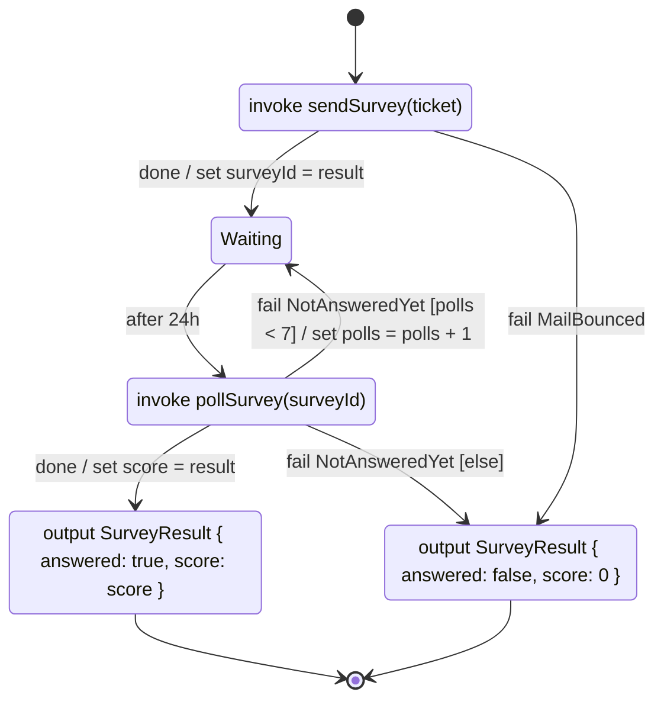

## SupportTicket

`examples/large/ticket.road:12`

```text
A support ticket from the moment it arrives until it is closed.
Every top-level final state is one way a ticket can end.
```



```mermaid
stateDiagram-v2
  state Intake {
    state "Classifying" as Intake_Classifying
    Intake_Classifying: invoke classify(ticket)
    state "ClassifyBackoff" as Intake_ClassifyBackoff
    Intake_ClassifyBackoff: entry set classifyAttempts = classifyAttempts + 1
    state "Screening" as Intake_Screening
    state "Unclassified" as Intake_Unclassified
    state "Accepted" as Intake_Accepted
    Intake_Accepted: entry do notifyCustomer(ticket, "received")
    [*] --> Intake_Classifying
    Intake_Classifying --> Intake_Screening: done / set classification = result, set priority = result.priority, set category = result.category
    Intake_Classifying --> Intake_ClassifyBackoff: fail ClassifierUnavailable [classifyAttempts < 3]
    Intake_Classifying --> Intake_Unclassified: fail ClassifierUnavailable [else]
    Intake_ClassifyBackoff --> Intake_Classifying: after backoff(classifyAttempts)
    Intake_Screening --> Intake_Accepted: always [else]
    Intake_Unclassified --> [*]
    Intake_Accepted --> [*]
  }
  state Triage {
    state "Routing" as Triage_Routing
    Triage_Routing: invoke routeTicket(ticket, category)
    state "Queued" as Triage_Queued
    state "Assigned" as Triage_Assigned
    Triage_Assigned: entry do notifyAgent(agentId, ticket, "assigned")
    [*] --> Triage_Routing
    Triage_Routing --> Triage_Assigned: done / set agentId = result
    Triage_Routing --> Triage_Queued: fail NoAgentAvailable
    Triage_Queued --> Triage_Routing: after 15m
    Triage_Assigned --> [*]
  }
  note right of Triage
    after triageSla(priority) / do pageOnCall(ticket, 1)
  end note
  state Active {
    state "Working" as Active_Working
    state Active_Working {
      state "WithAgent" as Active_Working_WithAgent
      state "WaitingOnCustomer" as Active_Working_WaitingOnCustomer
      state Active_Working_WaitingOnCustomer {
        state "Waiting" as Active_Working_WaitingOnCustomer_Waiting
        state "Reminded" as Active_Working_WaitingOnCustomer_Reminded
        state "LastCall" as Active_Working_WaitingOnCustomer_LastCall
        [*] --> Active_Working_WaitingOnCustomer_Waiting
        Active_Working_WaitingOnCustomer_Waiting --> Active_Working_WaitingOnCustomer_Reminded: after 72h / do notifyCustomer(ticket, "reminder")
        Active_Working_WaitingOnCustomer_Reminded --> Active_Working_WaitingOnCustomer_LastCall: after 96h / do notifyCustomer(ticket, "last_call")
      }
      state "OnHold" as Active_Working_OnHold
      [*] --> Active_Working_WithAgent
      Active_Working_WithAgent --> Active_Working_WithAgent: after 2h / do notifyAgent(agentId, ticket, "nudge")
      Active_Working_WithAgent --> Active_Working_WaitingOnCustomer: AgentReplied / do sendMessage(ticket, event.body)
      Active_Working_WithAgent --> Active_Working_OnHold: Hold
      Active_Working_WaitingOnCustomer --> Active_Working_WithAgent: CustomerReplied
      Active_Working_OnHold --> Active_Working_WithAgent: Unhold
      Active_Working_OnHold --> Active_Working_WithAgent: after 168h / do notifyAgent(agentId, ticket, "hold_expired")
    }
    state "Escalation" as Active_Escalation
    state Active_Escalation {
      state "Tier2" as Active_Escalation_Tier2
      Active_Escalation_Tier2: entry do pageOnCall(ticket, 2)
      state "Tier3" as Active_Escalation_Tier3
      Active_Escalation_Tier3: entry do pageOnCall(ticket, 3)
      state "Engineering" as Active_Escalation_Engineering
      state Active_Escalation_Engineering {
        state "FilingBug" as Active_Escalation_Engineering_FilingBug
        Active_Escalation_Engineering_FilingBug: invoke fileBug(ticket)
        state "BugBackoff" as Active_Escalation_Engineering_BugBackoff
        Active_Escalation_Engineering_BugBackoff: entry set bugAttempts = bugAttempts + 1
        state "AwaitingFix" as Active_Escalation_Engineering_AwaitingFix
        state "FixShipped" as Active_Escalation_Engineering_FixShipped
        [*] --> Active_Escalation_Engineering_FilingBug
        Active_Escalation_Engineering_FilingBug --> Active_Escalation_Engineering_AwaitingFix: done / set bugId = result
        Active_Escalation_Engineering_FilingBug --> Active_Escalation_Engineering_BugBackoff: fail TrackerUnavailable [bugAttempts < 5] / set retryWait = error.retryAfter
        Active_Escalation_Engineering_FilingBug --> Active_Escalation_Engineering_AwaitingFix: fail TrackerUnavailable [else] / do notifyAgent(agentId, ticket, "file_bug_by_hand")
        Active_Escalation_Engineering_BugBackoff --> Active_Escalation_Engineering_FilingBug: after retryWait
        Active_Escalation_Engineering_AwaitingFix --> Active_Escalation_Engineering_FixShipped: FixReleased
        Active_Escalation_Engineering_FixShipped --> [*]
      }
      [*] --> Active_Escalation_Tier2
      Active_Escalation_Tier2 --> Active_Escalation_Tier3: after 8h
      Active_Escalation_Tier3 --> Active_Escalation_Engineering: after 24h
    }
    state "Resolving" as Active_Resolving
    state Active_Resolving {
      state "FixCheck" as Active_Resolving_FixCheck
      state Active_Resolving_FixCheck {
        state "Verifying" as Active_Resolving_FixCheck_Verifying
        Active_Resolving_FixCheck_Verifying: invoke verifyFix(ticket)
        state "Verified" as Active_Resolving_FixCheck_Verified
        [*] --> Active_Resolving_FixCheck_Verifying
        Active_Resolving_FixCheck_Verifying --> Active_Resolving_FixCheck_Verified: done [result]
        Active_Resolving_FixCheck_Verified --> [*]
      }
      --
      state "CustomerNotice" as Active_Resolving_CustomerNotice
      state Active_Resolving_CustomerNotice {
        state "Drafting" as Active_Resolving_CustomerNotice_Drafting
        Active_Resolving_CustomerNotice_Drafting: invoke draftResolution(ticket)
        state "Drafted" as Active_Resolving_CustomerNotice_Drafted
        [*] --> Active_Resolving_CustomerNotice_Drafting
        Active_Resolving_CustomerNotice_Drafting --> Active_Resolving_CustomerNotice_Drafted: done / set resolution = result
        Active_Resolving_CustomerNotice_Drafted --> [*]
      }
    }
    state "AwaitingConfirmation" as Active_AwaitingConfirmation
    state "Reopened" as Active_Reopened
    Active_Reopened: entry set reopens = reopens + 1
    [*] --> Active_Working
    Active_Working --> Active_Escalation: Escalate
    Active_Working_WithAgent --> Active_Resolving: Resolve
    Active_Escalation --> Active_Working: Deescalate
    Active_Escalation --> Active_Resolving: Resolve
    Active_Escalation_Engineering --> Active_Resolving: done
    Active_Resolving --> Active_AwaitingConfirmation: done / do sendMessage(ticket, resolution)
    Active_Resolving_FixCheck_Verifying --> Active_Working: done [else] / do notifyAgent(agentId, ticket, "fix_failed")
    Active_AwaitingConfirmation --> Active_Reopened: Reopen
    Active_Reopened --> Active_Working: always [reopens < 3]
    Active_Reopened --> Active_Escalation: always [else]
  }
  note right of Active
    after resolutionSla(priority) / do pageOnCall(ticket, 2)
    on InternalNote / do addNote(ticket, event.text)
    on FollowUpIn / raise FollowUp after event.delay as followUp
    on FollowUp / do notifyAgent(agentId, ticket, "follow_up")
  end note
  state Closing {
    state "Surveying" as Closing_Surveying
    Closing_Surveying: invoke machine SatisfactionSurvey(ticket)
    state "Surveyed" as Closing_Surveyed
    [*] --> Closing_Surveying
    Closing_Surveying --> Closing_Surveyed: done / set survey = result
    Closing_Surveyed --> [*]
  }
  note right of Closing
    entry cancel followUp
  end note
  Resolved: output ratedClosure(ticket, reopens, survey)
  AutoClosed: output closure(ticket, CloseReason.AutoClosed, reopens)
  Spam: output closure(ticket, CloseReason.Spam, reopens)
  Duplicate: output closure(ticket, CloseReason.Duplicate, reopens)
  Withdrawn: output closure(ticket, CloseReason.Withdrawn, reopens)
  OutOfScope: output closure(ticket, CloseReason.OutOfScope, reopens)
  Merged: output closure(ticket, CloseReason.Merged, reopens)
  Unresolvable: output closure(ticket, CloseReason.Unresolvable, reopens)
  [*] --> Intake
  Intake --> Triage: done
  Intake_Screening --> Spam: always [isSpam(classification)]
  Intake_Screening --> Duplicate: always [isDuplicate(classification)]
  Triage --> Triage_Assigned: Assign / set agentId = event.agentId
  Triage --> OutOfScope: MarkOutOfScope
  Triage --> Withdrawn: CustomerWithdrew
  Triage --> Active: done
  Active --> Withdrawn: CustomerWithdrew
  Active --> Merged: MergeInto
  Active_Working_WithAgent --> Duplicate: MarkDuplicate
  Active_Working_WaitingOnCustomer --> AutoClosed: after 336h
  Active_Escalation_Engineering_AwaitingFix --> Unresolvable: GiveUp
  Active_AwaitingConfirmation --> Closing: CustomerConfirmed
  Active_AwaitingConfirmation --> Closing: after 168h
  Closing --> Resolved: done
  Resolved --> [*]
  AutoClosed --> [*]
  Spam --> [*]
  Duplicate --> [*]
  Withdrawn --> [*]
  OutOfScope --> [*]
  Merged --> [*]
  Unresolvable --> [*]
```

## SatisfactionSurvey

`examples/large/survey.road:4`

```text
Send a satisfaction survey and wait up to a week for the answer.
```


