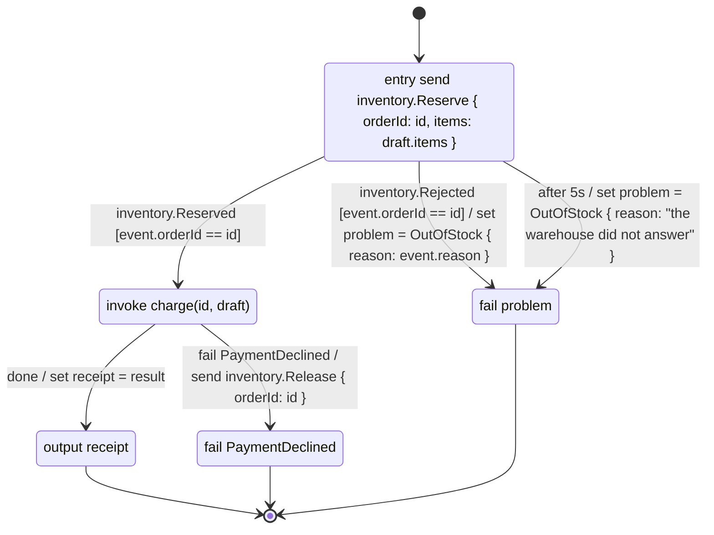
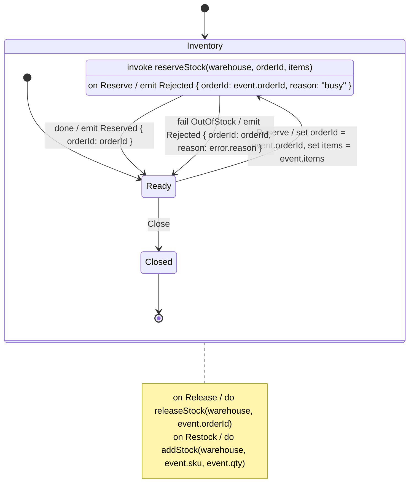

## Order

`examples/orders/orders.road:18`

```text
Reserve the items with the warehouse, then take the payment. The warehouse is a peer that
lives longer than any order: whoever starts the order passes it in.
```



## Inventory

`inventory.road:19`

```text
The stock of one warehouse, shared by every order. An order asks it to reserve items, and
it answers by emitting `Reserved` or `Rejected` with the order's id, which every holder of
a reference to it receives.
```


