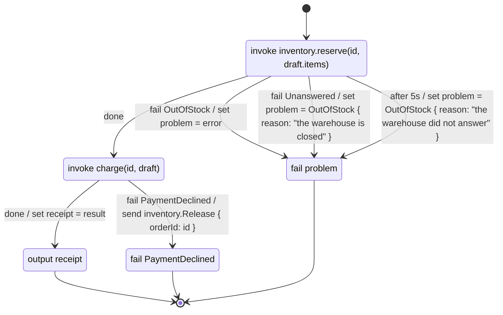
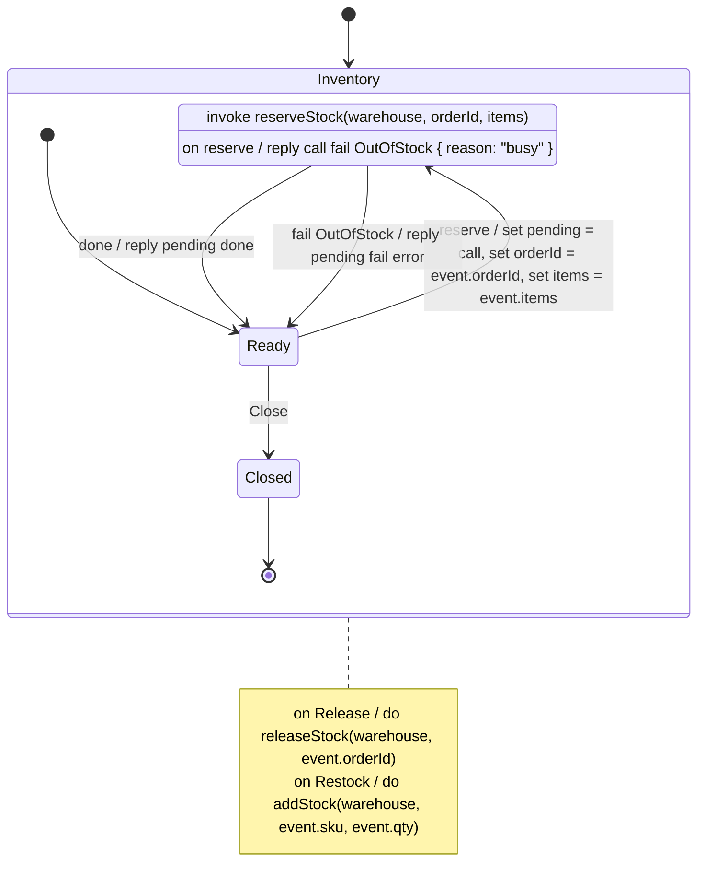

## Order

`examples/orders/orders.road:18`

```text
Reserve the items with the warehouse, then take the payment. The warehouse is a peer that
lives longer than any order: whoever starts the order passes it in.
```



## Inventory

`inventory/inventory.road:18`

```text
The stock of one warehouse, shared by every order. An order calls `reserve`, and the answer
goes to that order alone.
```


