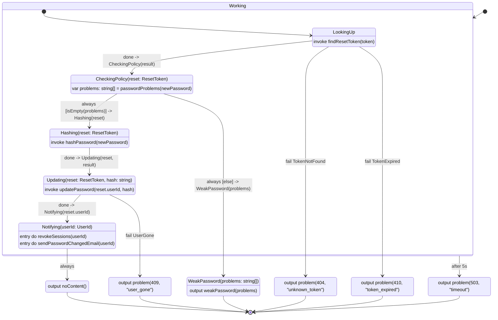

## ConfirmPasswordReset

`examples/password-reset/confirm.road:11`

```text
POST /password-reset/confirm: exchange a reset token and a new password
for a changed password. Every final state is one HTTP response.
```


