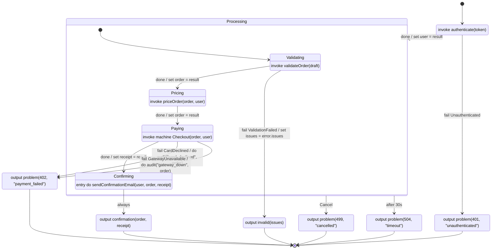
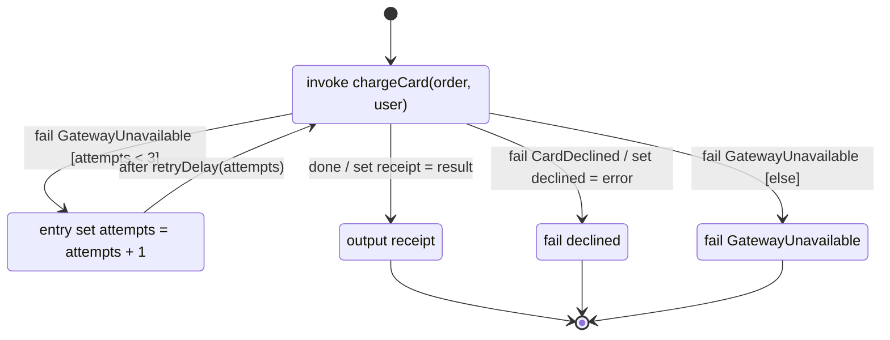

## PlaceOrder

`examples/shop/place_order.road:11`

```text
POST /orders: authenticate, validate, price, take payment, confirm.
Every final state is one HTTP response.
```



## Checkout

`examples/shop/checkout.road:4`

```text
Charge the customer's card, retrying while the payment gateway is down.
```


