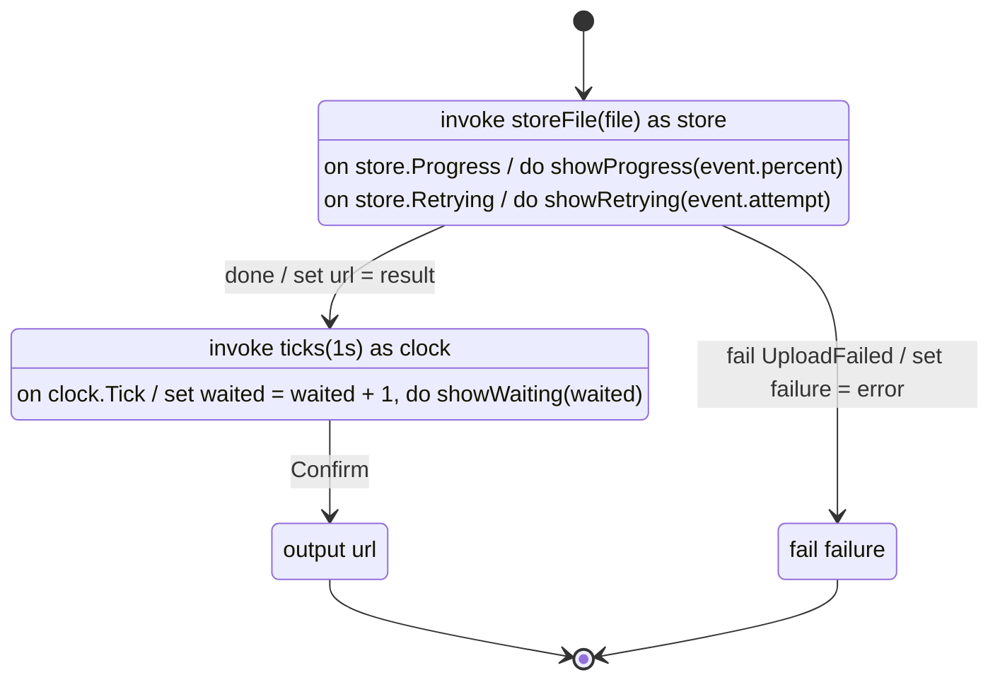
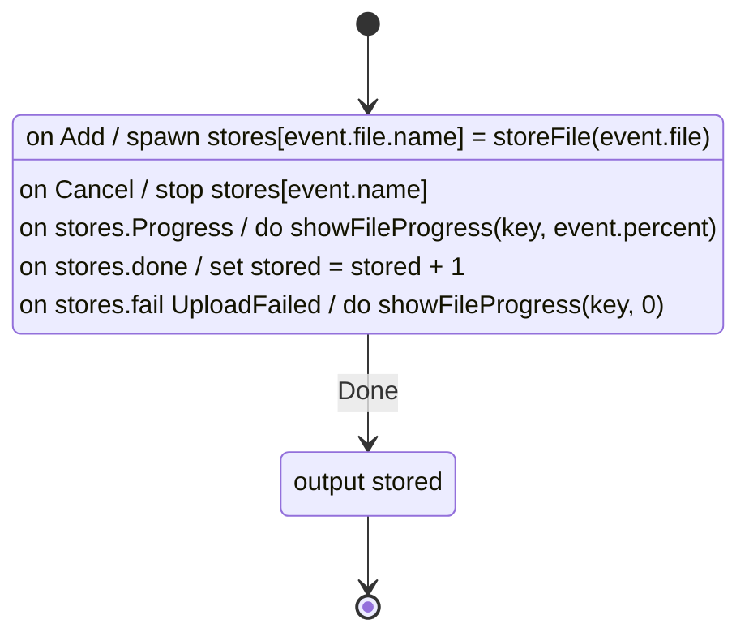
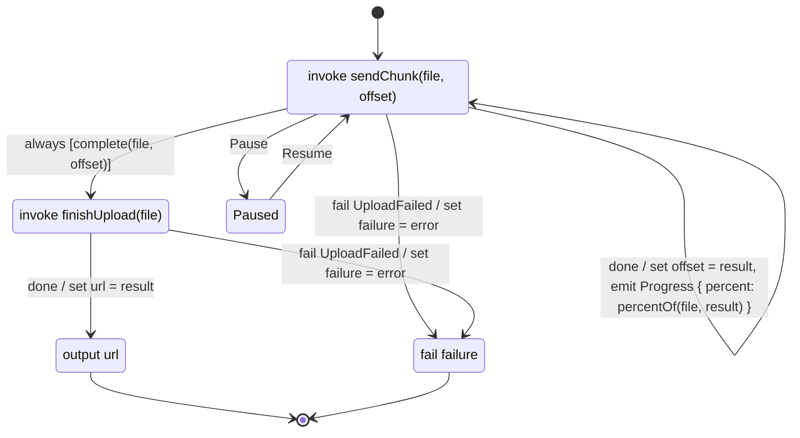

## Attach

`examples/upload/attach.road:26`

```text
Attach a file to a message: store it with a task that reports its progress, then wait for
the user to confirm, showing how long they have waited.
```



## AttachMany

`examples/upload/attach.road:58`

```text
Attach several files at once: one `storeFile` task per file, keyed by the file's name, in a
collection of tasks. Counts the files stored.
```



## Upload

`examples/upload/upload.road:23`

```text
Upload a file in chunks. Can be paused, and reports its progress to whoever invoked it.
```


