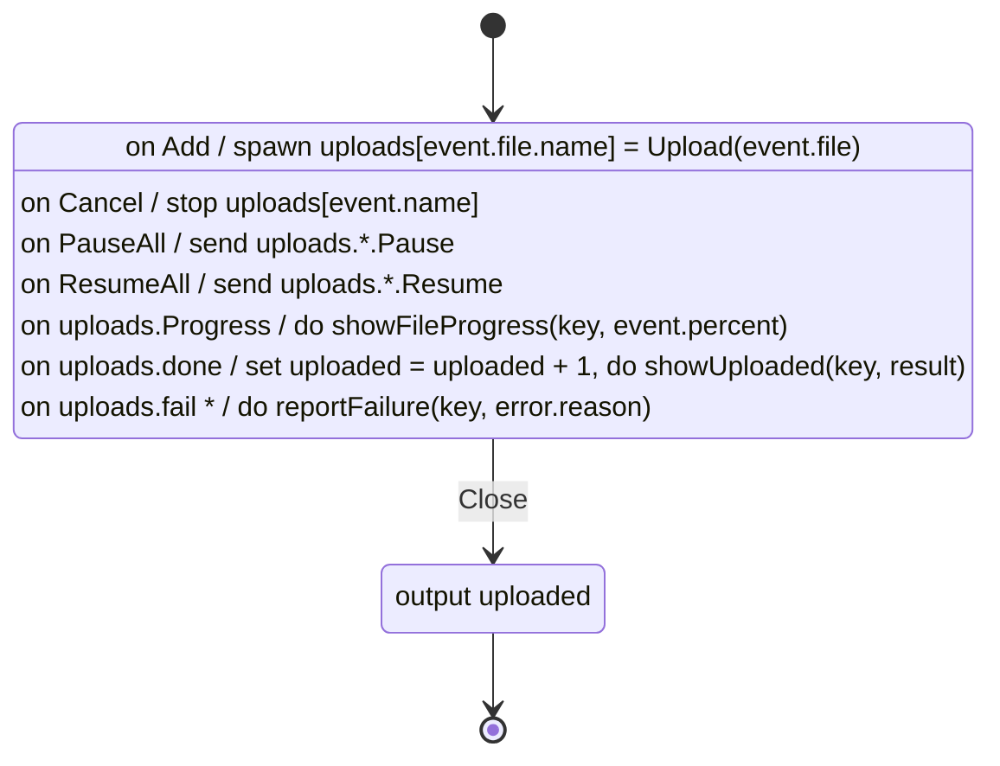
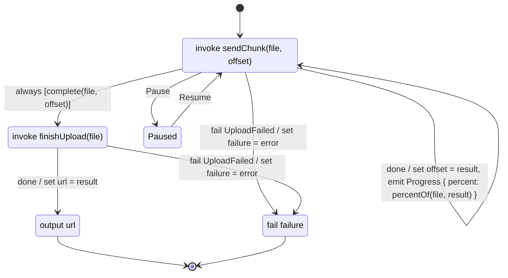

## Batch

`examples/upload/batch.road:14`

```text
Upload any number of files at once: one `Upload` per file, keyed by the file's name. The
user can add files while others upload, cancel one, and pause and resume them all.
```



## Upload

`examples/upload/upload.road:23`

```text
Upload a file in chunks. Can be paused, and reports its progress to whoever invoked it.
```


