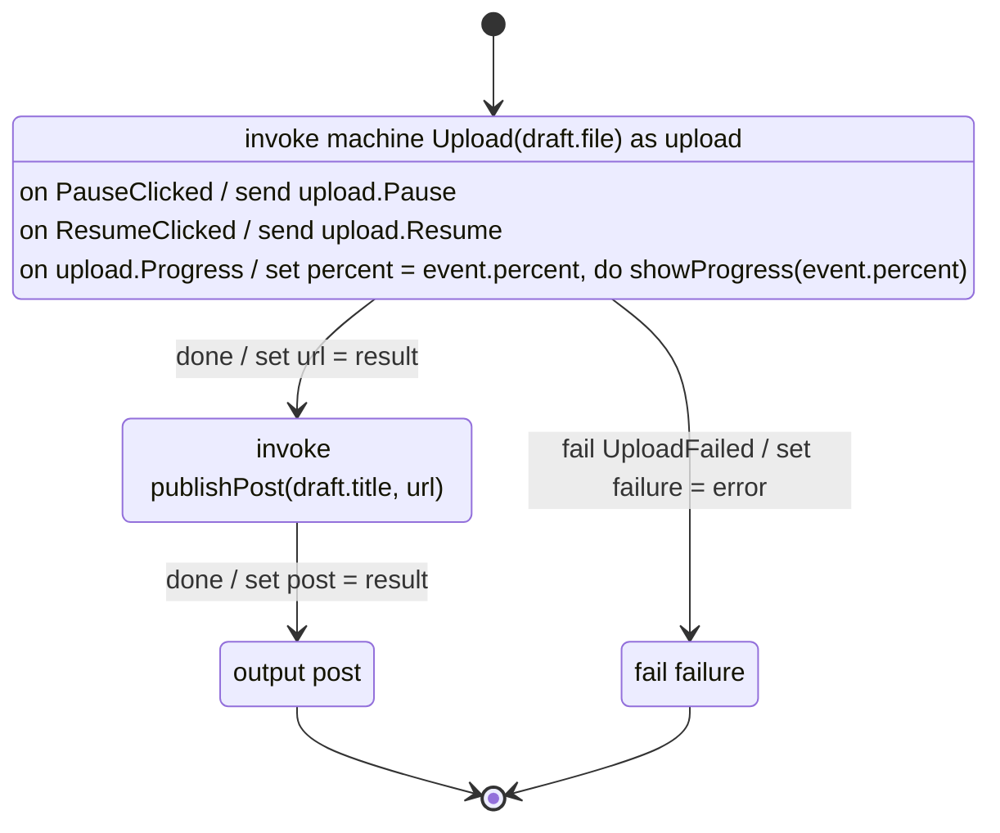
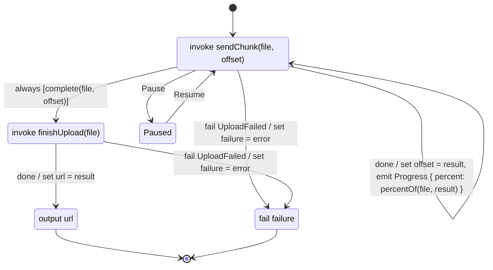

## Publish

`examples/upload/publish.road:17`

```text
Publish a post once its attachment is uploaded. The user can pause and resume the upload
and sees its progress.
```



## Upload

`examples/upload/upload.road:23`

```text
Upload a file in chunks. Can be paused, and reports its progress to whoever invoked it.
```


