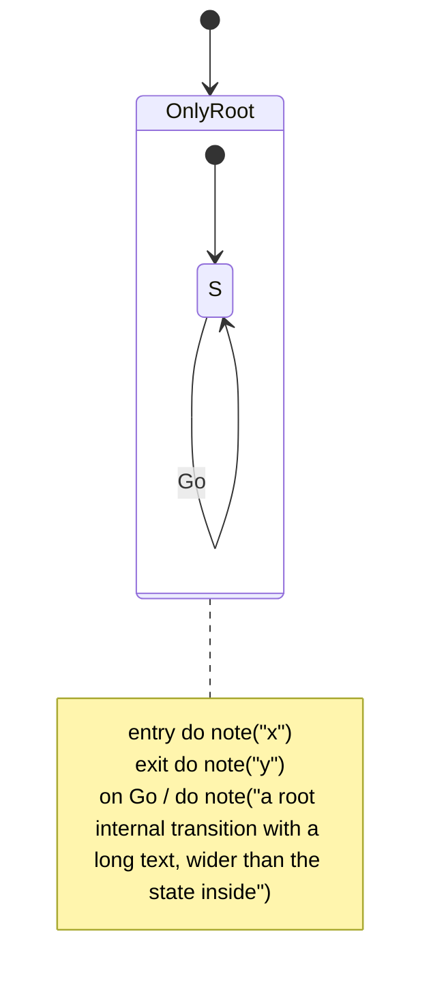
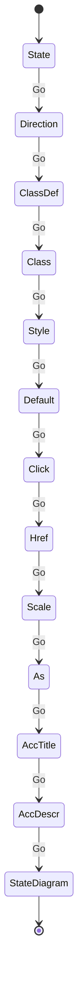
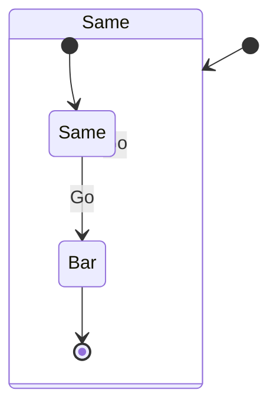
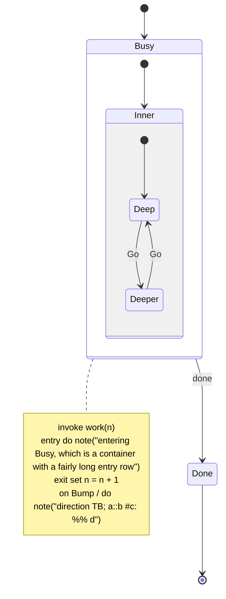

## OnlyRoot

`packages/viewer/test/charts/edges.road:12`

````text
A root with rows of its own, wider than everything inside it.
```
a fence in a doc, then <b>HTML</b> & an ending fence:
```
````



## Note

`packages/viewer/test/charts/edges.road:22`

```text
States Mermaid would read as keywords.
```



## Same

`packages/viewer/test/charts/edges.road:41`

```text
A state named like its machine, which has transitions of its own.
```



## Rows

`packages/viewer/test/charts/edges.road:50`

```text
Containers with an invoke, entry, exit and internal transitions, and labels with syntax.
```


