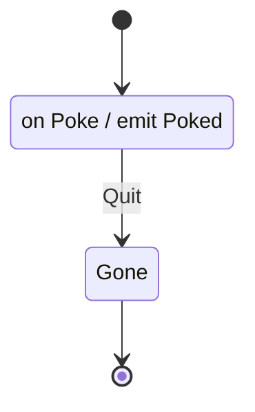
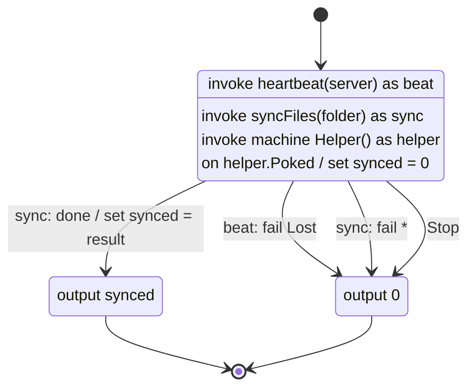

## Helper

`packages/viewer/test/charts/invokes.road:13`

```text
Answers a poke.
```



## Watch

`packages/viewer/test/charts/invokes.road:29`

```text
Watches a server while it syncs a folder, with a helper beside them.
```


