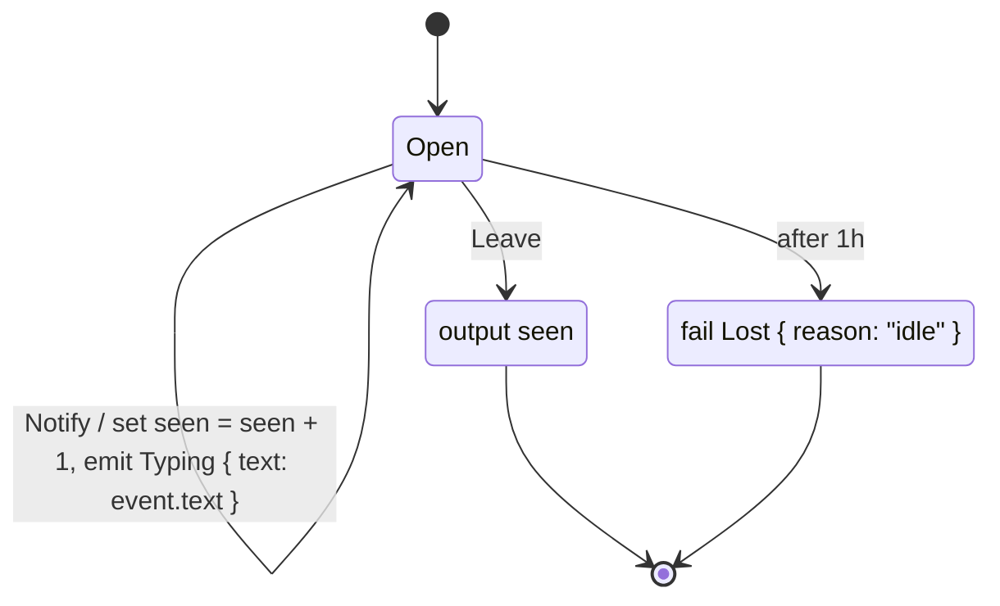
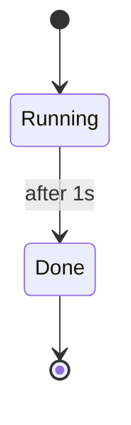
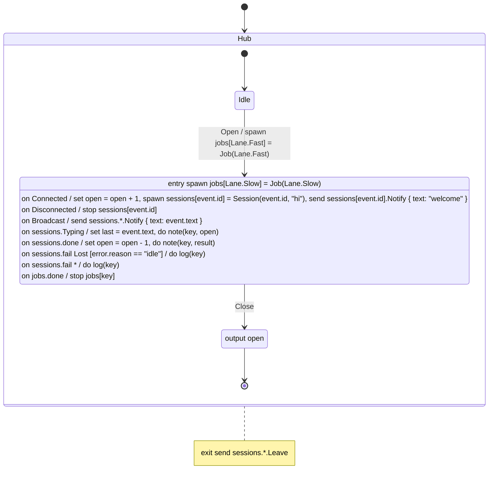

## Session

`packages/viewer/test/charts/spawn.road:16`

```text
One connection.
```



## Job

`packages/viewer/test/charts/spawn.road:34`

```text
A job with no result.
```



## Hub

`packages/viewer/test/charts/spawn.road:41`

```text
Many sessions, one per connection.
```


