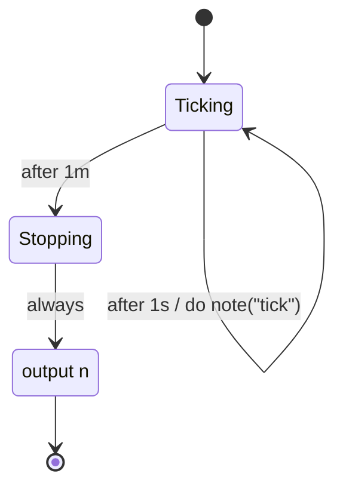
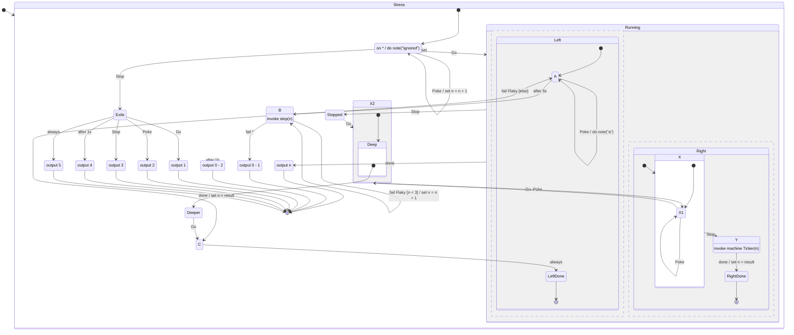

## Ticker

`packages/viewer/test/charts/stress.road:11`

```text
Ticks on its own.
```



## Stress

`packages/viewer/test/charts/stress.road:22`

```text
Every shape the viewer has to lay out, at once.
```


