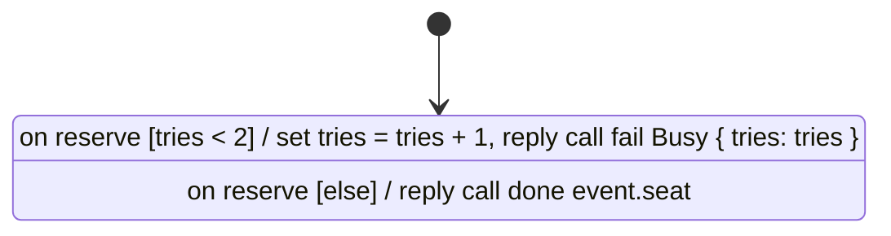
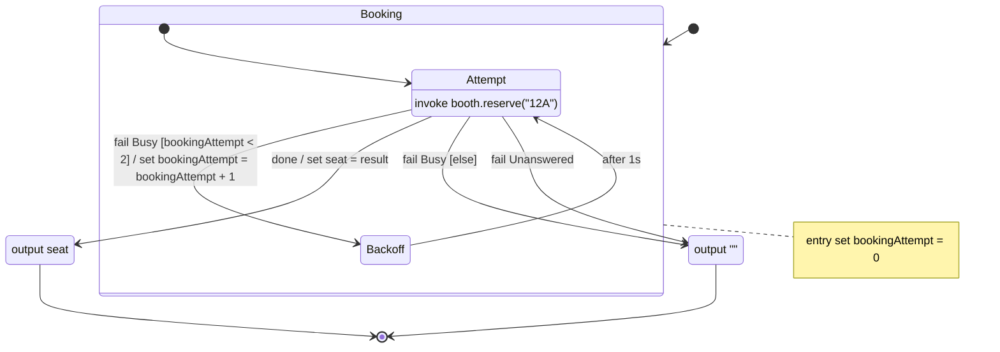

## Booth

`spec/conformance/charts/booth.road:8`

```text
Books seats, once it has been asked enough times.
```



## Guest

`spec/conformance/charts/booth.road:25`

```text
Books a seat, retrying while the booth is busy.
```


