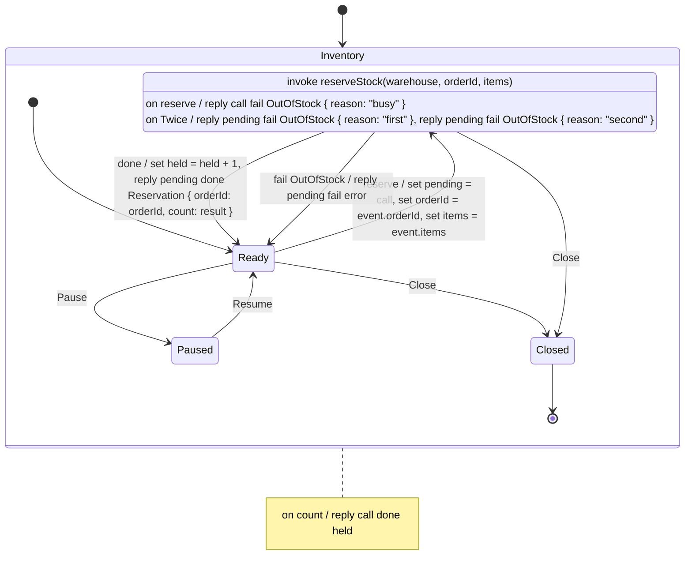
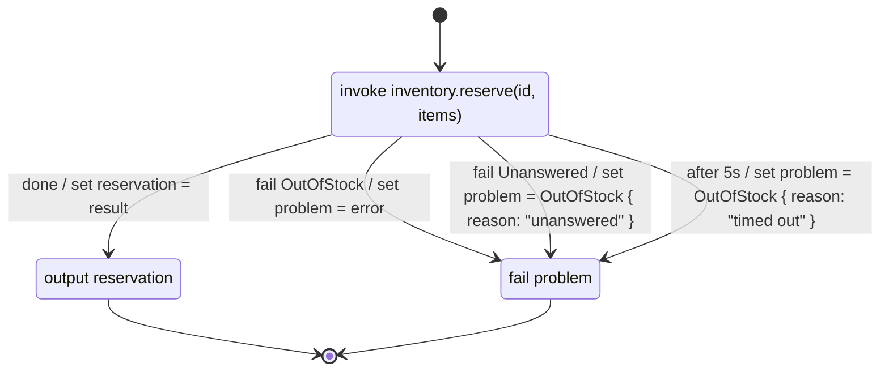
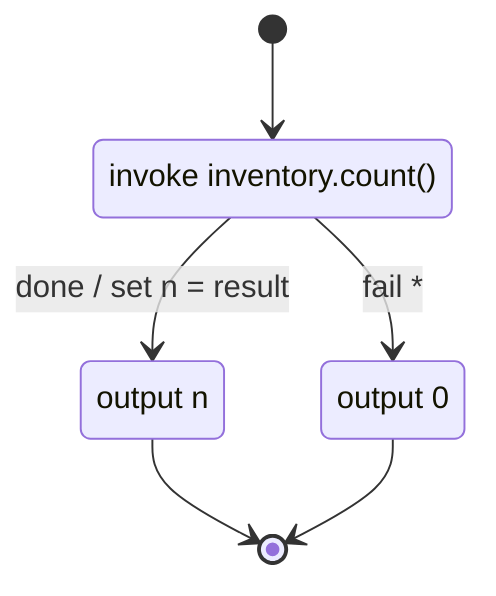

## Inventory

`spec/conformance/charts/calls.road:19`

```text
The stock of one warehouse, shared by every order.
```



## Order

`spec/conformance/charts/calls.road:64`

```text
Reserve the items with the warehouse, giving up after 5s.
```



## Counter

`spec/conformance/charts/calls.road:84`

```text
Ask the warehouse how many reservations it holds; 0 if it cannot say.
```


