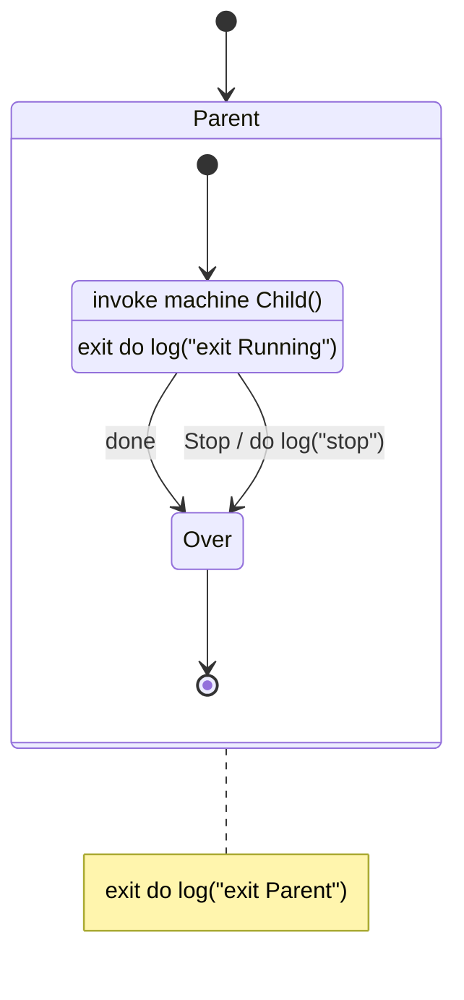
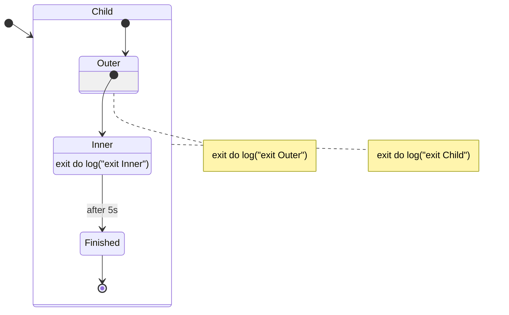

## Parent

`spec/conformance/charts/cancel.road:7`

```text
Runs Child until Stop, then ends.
```



## Child

`spec/conformance/charts/cancel.road:27`

```text
Waits five seconds two levels down, logging every exit.
```


