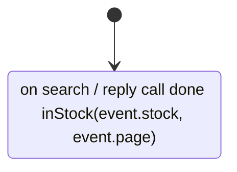
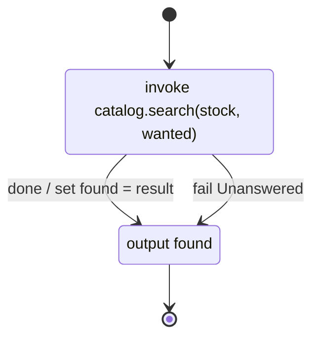

## Catalog

`spec/conformance/charts/catalog.road:14`

```text
Searches its stock for the items it is asked about.
```



## Shopper

`spec/conformance/charts/catalog.road:24`

```text
Asks the catalog which of the items it wants are in stock.
```


