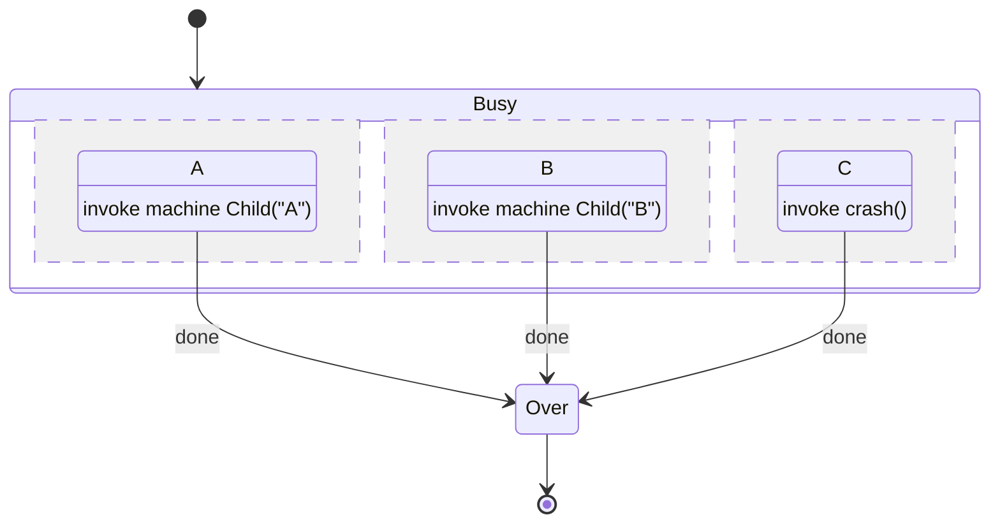
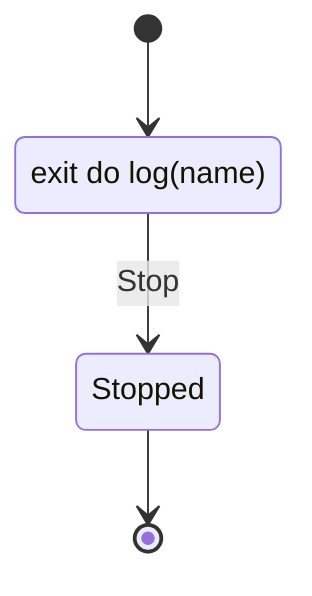

## Crash

`spec/conformance/charts/crash.road:8`

```text
Runs two children and a task, one in each region.
```



## Child

`spec/conformance/charts/crash.road:35`

```text
Waits for Stop, which never comes, logging its exit.
```


