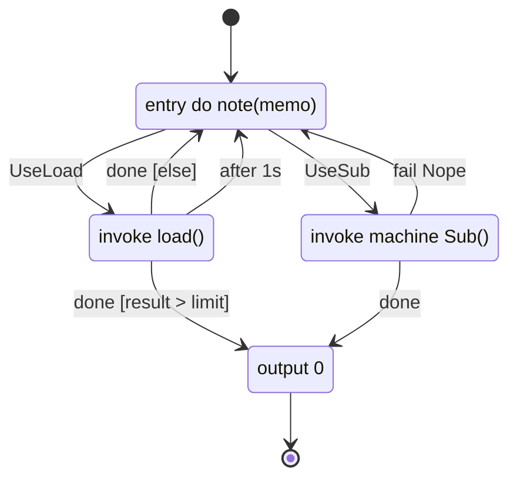
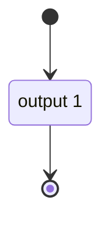

## Main

`spec/conformance/charts/defects.road:13`

```text
Loads a number or asks Sub for one.
```



## Sub

`spec/conformance/charts/defects.road:51`

```text
Stubbed in the cases that use it.
```


