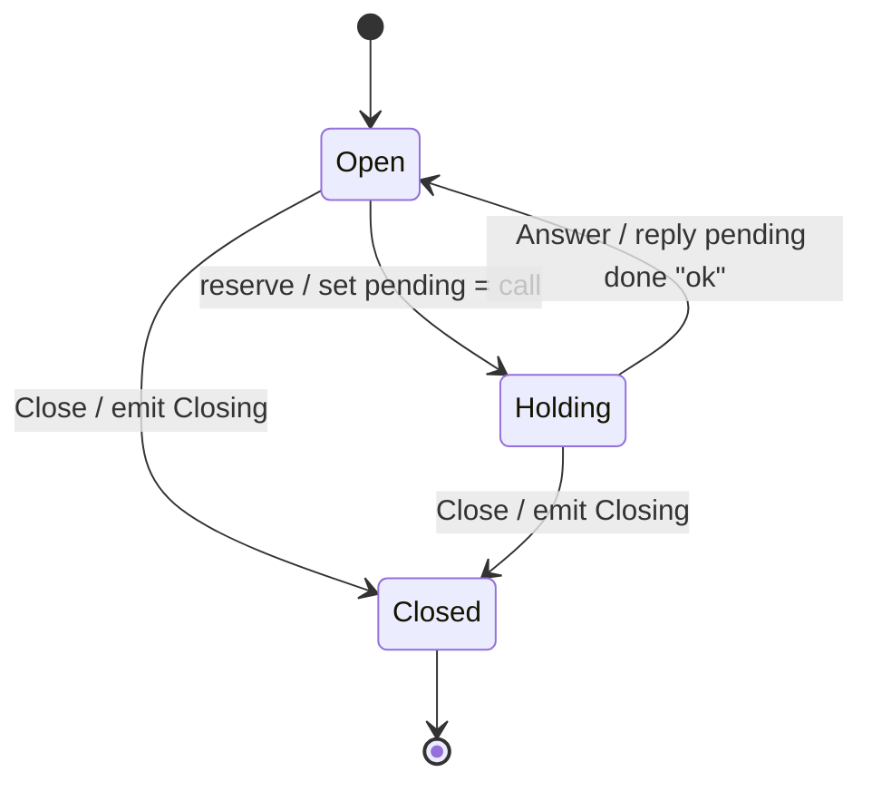
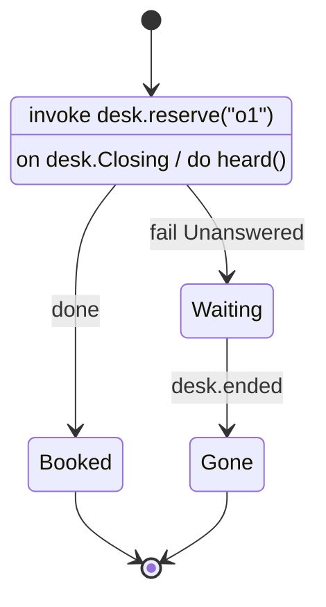

## Desk

`spec/conformance/charts/ended-order.road:9`

```text
Takes a reservation and keeps the call pending until Answer.
```



## Booker

`spec/conformance/charts/ended-order.road:35`

```text
Asks the desk for a reservation and waits for the desk to end.
```


