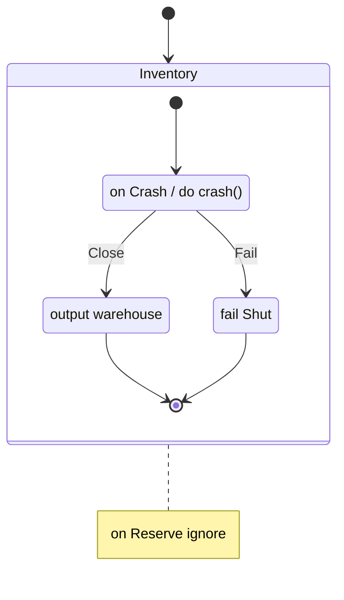
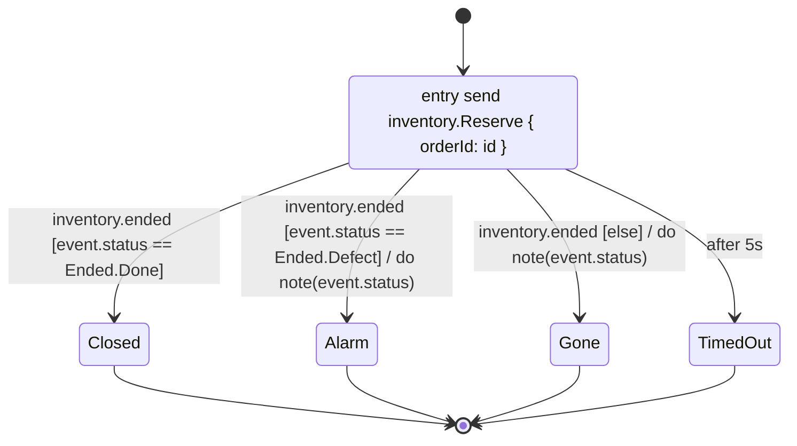
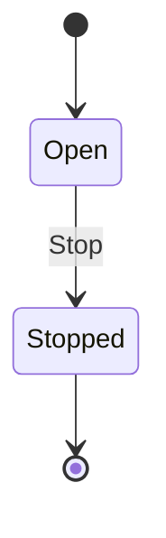
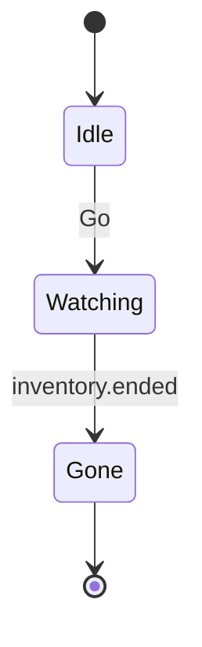
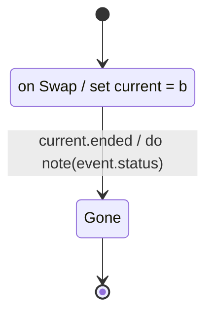

## Inventory

`spec/conformance/charts/ended.road:16`

```text
The stock of one warehouse, which ends when asked to: done on Close, failed
on Fail, with a defect on Crash (when `crash` has one).
```



## Order

`spec/conformance/charts/ended.road:38`

```text
Asks the warehouse for stock and waits for it, until it ends or 5s pass.
How the warehouse ended decides where the order goes.
```



## Clerk

`spec/conformance/charts/ended.road:59`

```text
Holds a `ref` to the warehouse but has no `on inventory.ended`: it is not
told when the warehouse ends.
```



## Picker

`spec/conformance/charts/ended.road:71`

```text
Hears the warehouse's end only while it is Watching: an end that arrives
while it is Idle is dropped.
```



## Guard

`spec/conformance/charts/ended.road:85`

```text
As Picker, but strict: an end that no transition takes is still dropped,
never `unhandled`.
```


## Switcher

`spec/conformance/charts/ended.road:99`

```text
Watches the warehouse its variable `current` holds: `a`, then `b` after
Swap. The end of a run `current` no longer holds is dropped.
```


