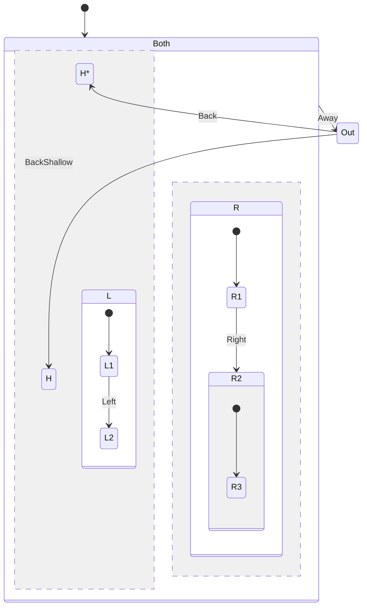
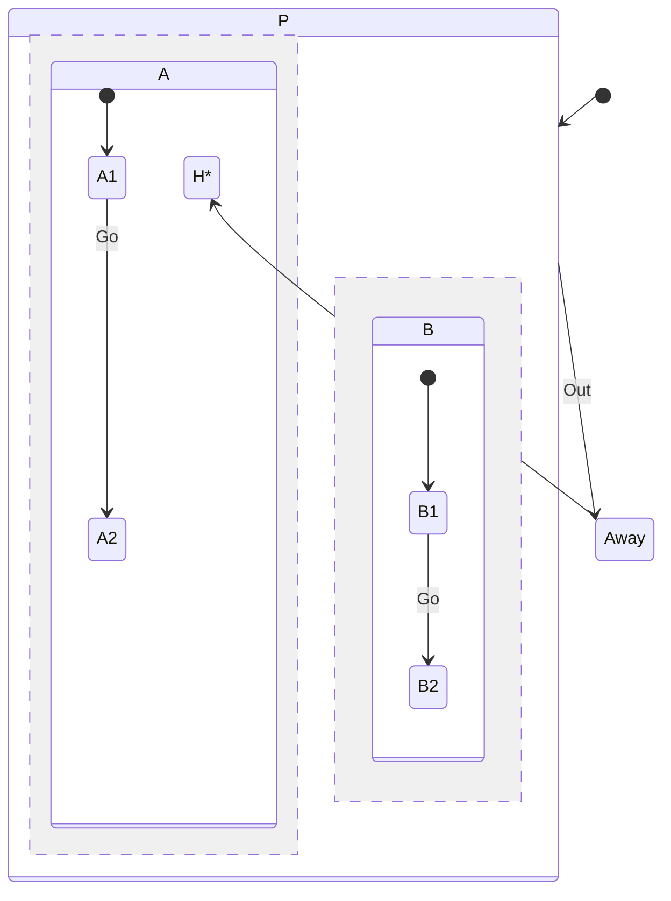

## Panels

`spec/conformance/charts/history-regions.road:5`

```text
History states of a parallel state.
```



## Region

`spec/conformance/charts/history-regions.road:43`

```text
The history state of a compound state in one region of a parallel state.
```


