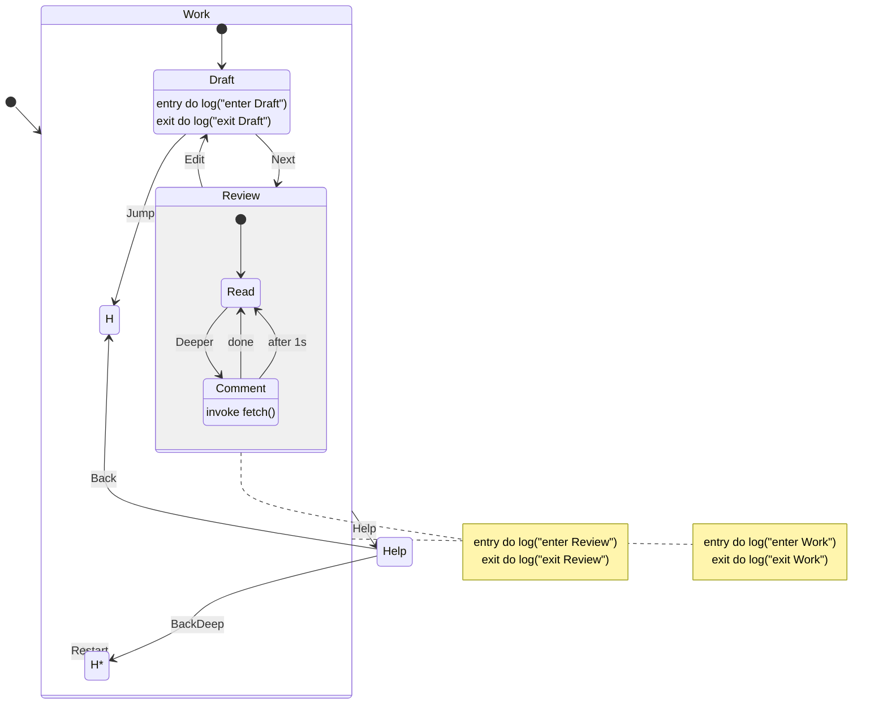
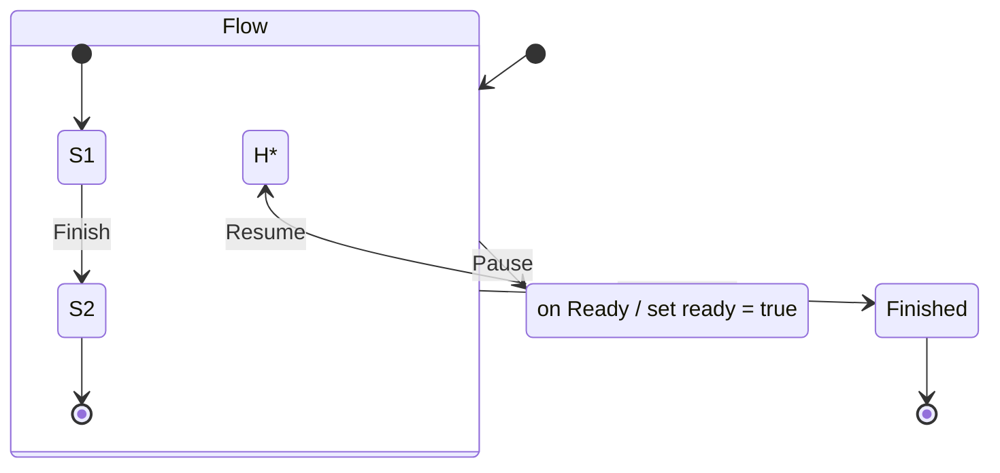
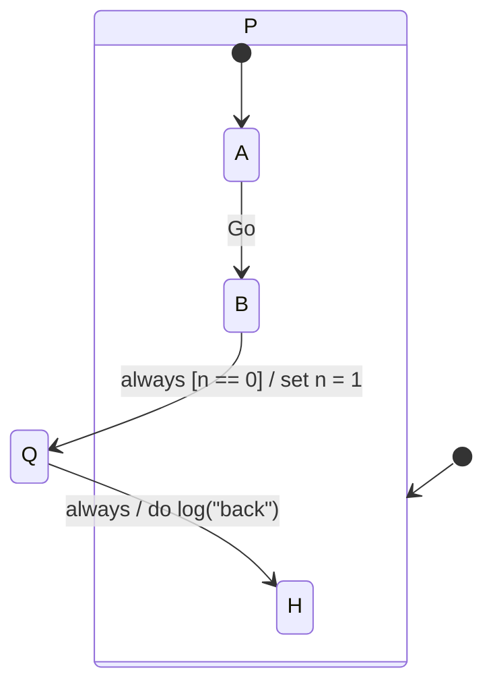

## Editor

`spec/conformance/charts/history.road:10`

```text
Shallow and deep history of one compound state.
```



## Steps

`spec/conformance/charts/history.road:66`

```text
A deep history state that restores a final state, completing its parent.
```



## Bounce

`spec/conformance/charts/history.road:96`

```text
A parent left and returned to through its history state while settling.
```


