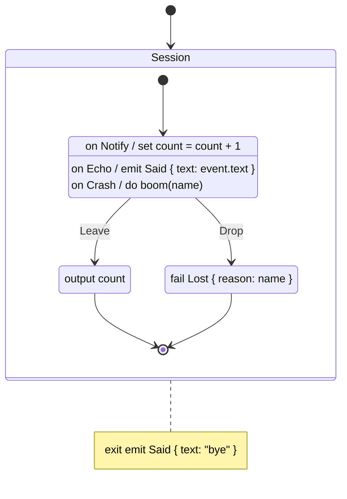
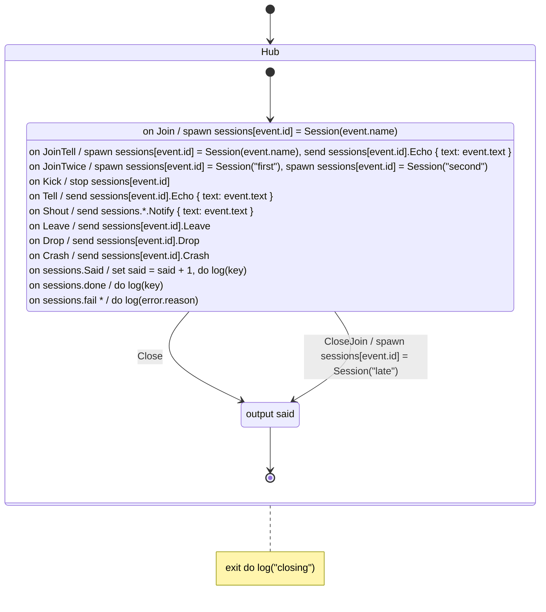
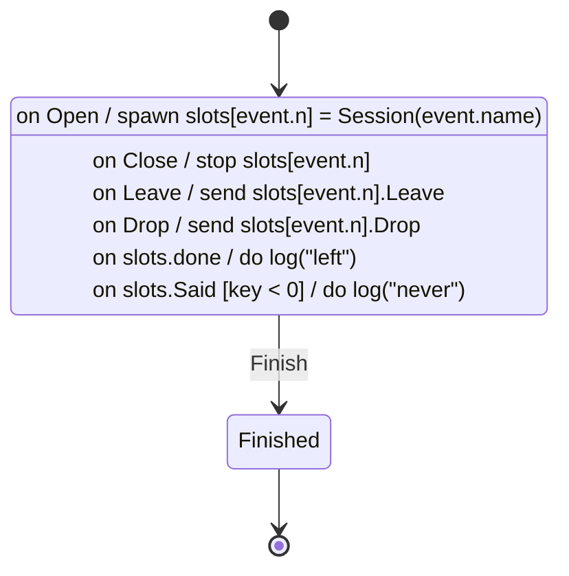

## Session

`spec/conformance/charts/hub.road:9`

```text
One connection. It counts what it is told, and says back what it is asked to echo.
```



## Hub

`spec/conformance/charts/hub.road:33`

```text
Spawns, addresses and stops sessions by key.
```



## Pool

`spec/conformance/charts/hub.road:73`

```text
Keyed by number: handles only its children's ending, and can be saved while they run. It
hears what they say (so it is delivered, and dropped or stale) but never takes it.
```


