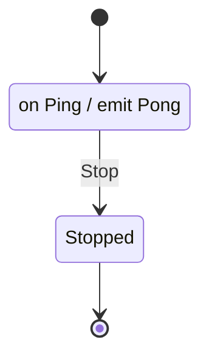
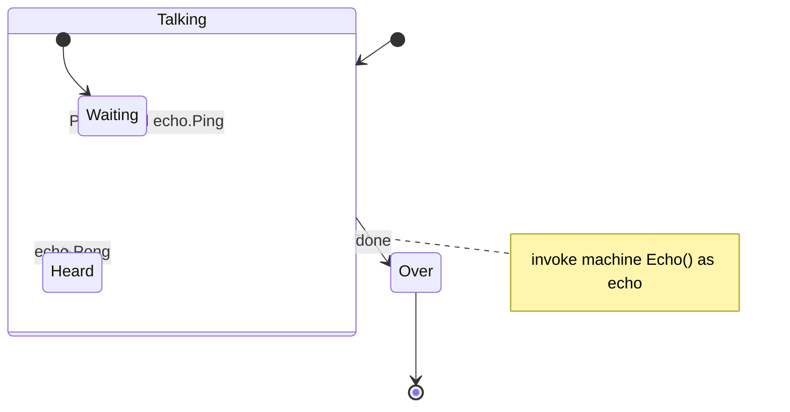

## Echo

`spec/conformance/charts/internal-child.road:4`

```text
A child that answers every `Ping` with a `Pong`.
```



## Caller

`spec/conformance/charts/internal-child.road:21`

```text
An internal transition written in the invoking state does not leave it, so its child keeps
running and can be sent to from the transition itself.
```


