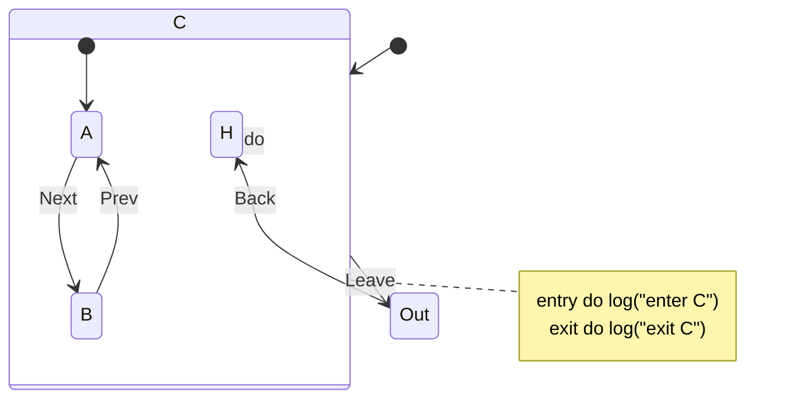

## Restore

`spec/conformance/charts/internal-history.road:7`

```text
An internal transition to a history state of its own source restores what the source was
in when it was last left, without leaving it.
```


