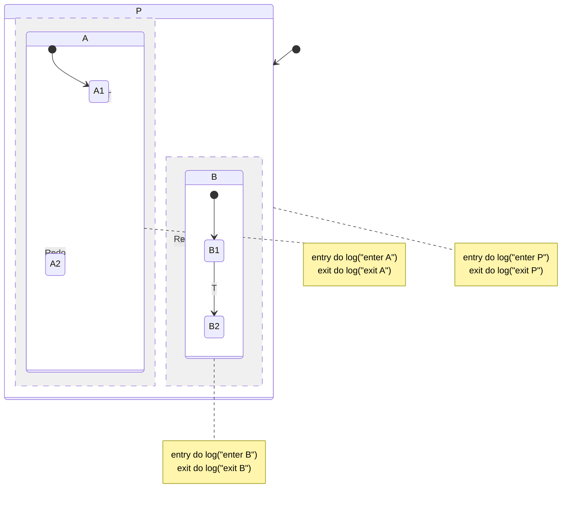

## Sides

`spec/conformance/charts/internal-parallel.road:8`

```text
Internal transitions in a parallel state: one written in a region stays in it, so another
region takes the same event too; one written in the parallel state exits and enters only
the regions it targets.
```


