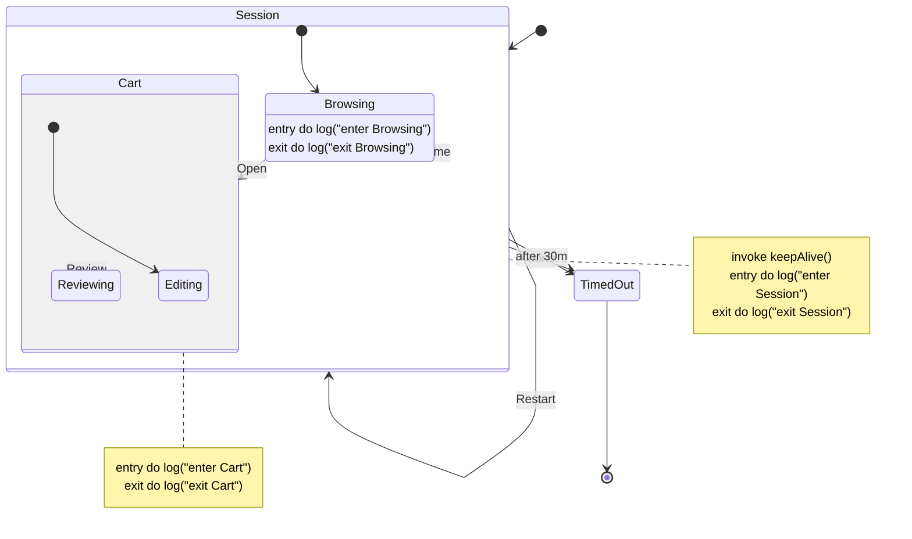
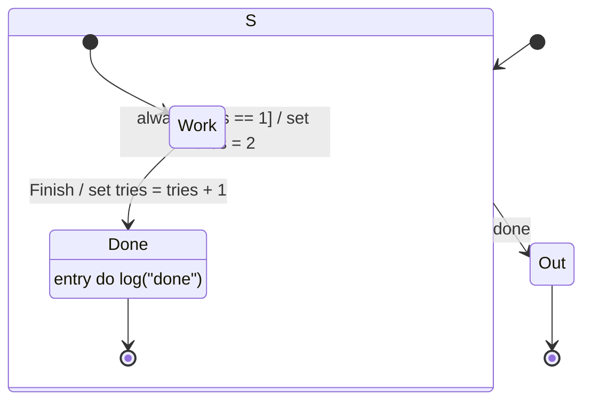

## Kept

`spec/conformance/charts/internal.road:9`

```text
`Session` keeps its timer and its invoke when an internal transition changes the states
below it; an external one restarts both.
```



## Again

`spec/conformance/charts/internal.road:50`

```text
An internal transition that exits a final state takes back its parent's completion: the
first time `Work` ends, `S`'s `always` goes back into it before `S`'s `done` is tried.
```


