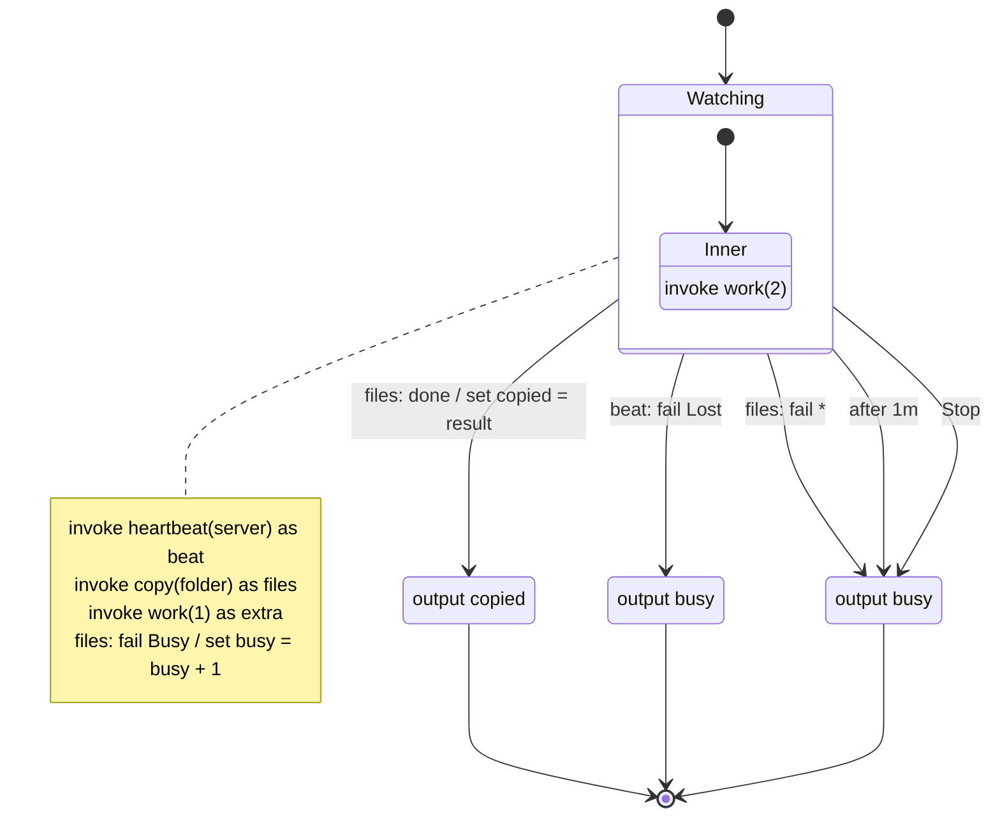
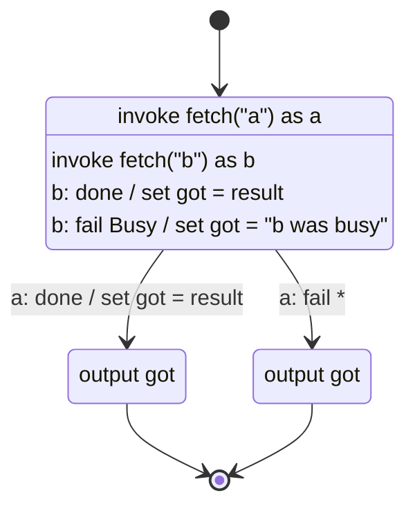
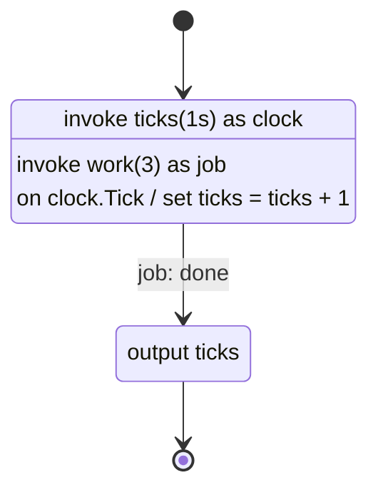
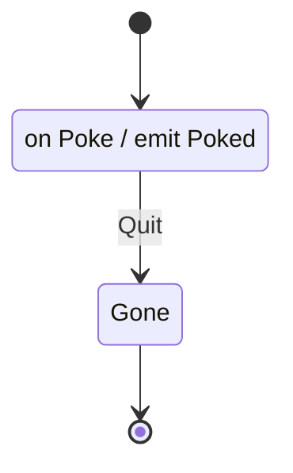
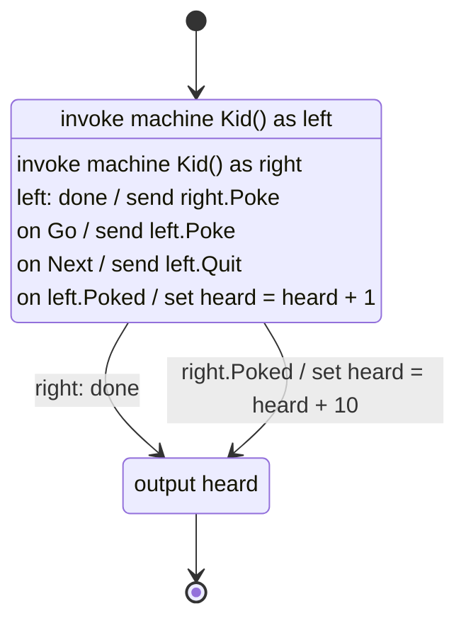

## Watch

`spec/conformance/charts/invokes.road:25`

```text
Three invokes and a timer in one state, and one more invoke in its child state.
```



## Lookup

`spec/conformance/charts/invokes.road:58`

```text
The same task twice in one state, told apart by `as`: `a`'s `fail *` is not `b`'s.
```



## Ticker

`spec/conformance/charts/invokes.road:79`

```text
A stream task beside the work that ends the state.
```



## Kid

`spec/conformance/charts/invokes.road:96`

```text
Answers a poke, and ends when told to quit.
```



## Twins

`spec/conformance/charts/invokes.road:113`

```text
Two children in one state: each is sent to and heard from by its name, and the outcome of
one may send to the other, which is still running.
```


