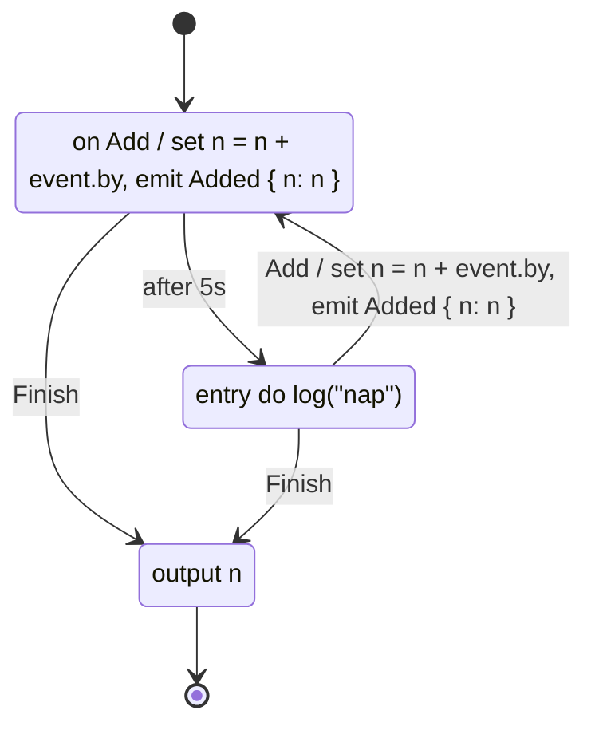
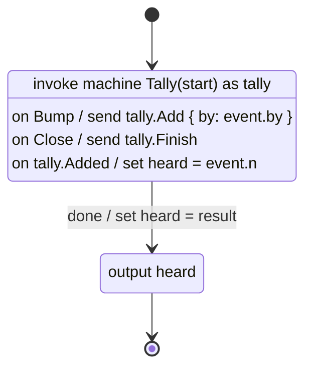
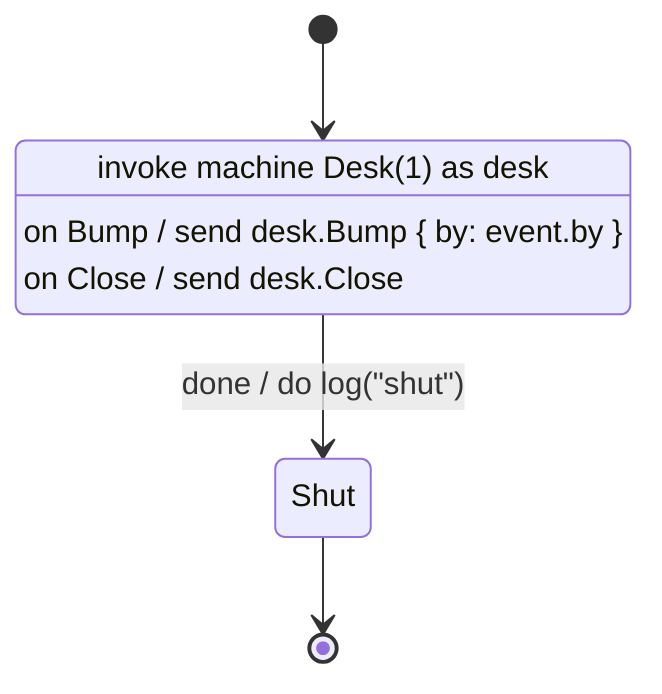
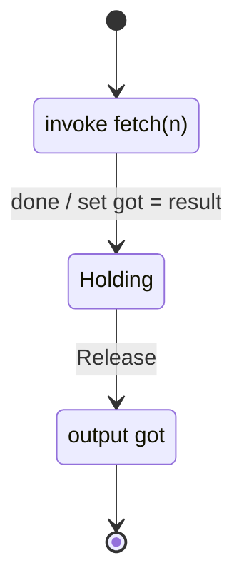
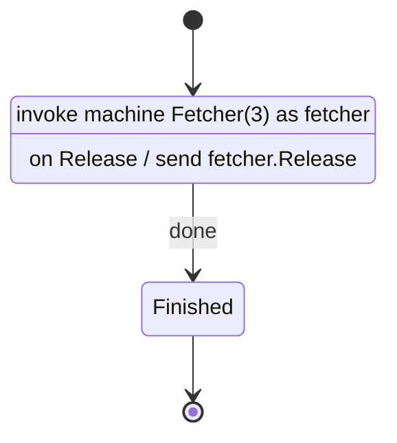
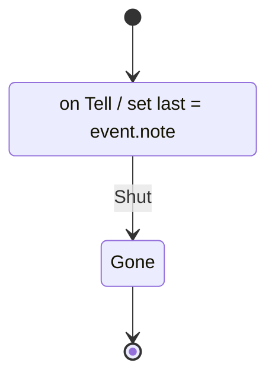
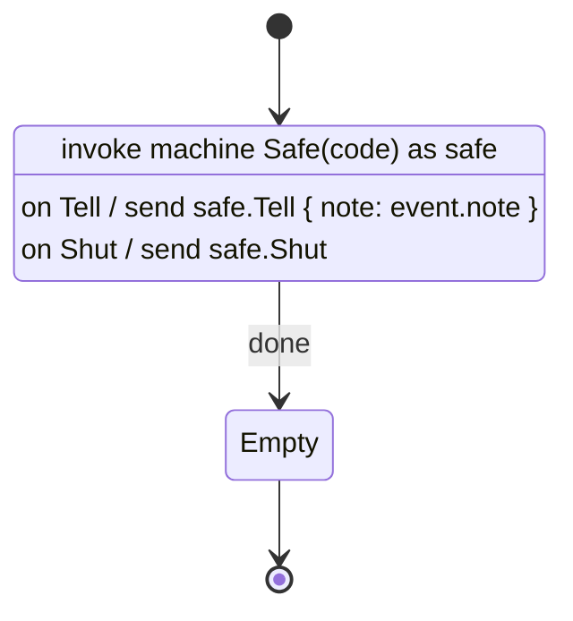

## Tally

`spec/conformance/charts/kept.road:9`

```text
Counts what its parent sends it, and naps after five seconds without news.
```



## Desk

`spec/conformance/charts/kept.road:36`

```text
Keeps a Tally, passes on what it is told, and hears what it counts.
```



## Office

`spec/conformance/charts/kept.road:58`

```text
Keeps a Desk: two levels of child runs.
```



## Fetcher

`spec/conformance/charts/kept.road:77`

```text
Fetches a number, then holds it until it is released.
```



## Errand

`spec/conformance/charts/kept.road:96`

```text
Keeps a Fetcher, and releases it when told.
```



## Safe

`spec/conformance/charts/kept.road:113`

```text
Keeps a secret given to it, and what it was last told.
```



## Vault

`spec/conformance/charts/kept.road:130`

```text
Keeps a Safe, and passes on what it is told.
```


