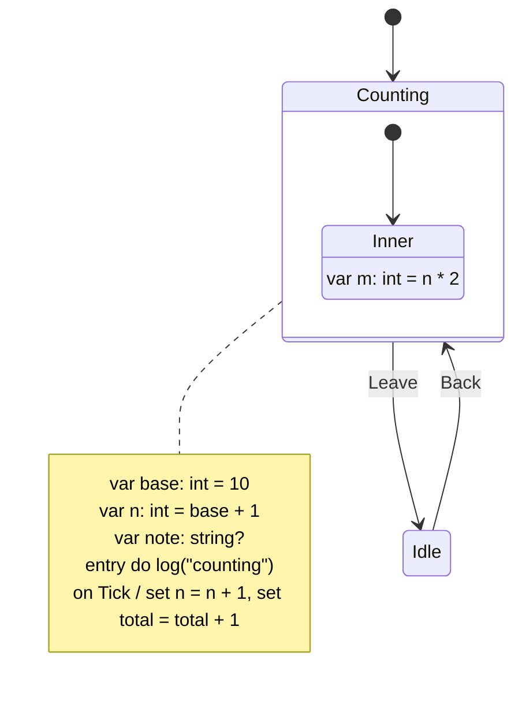
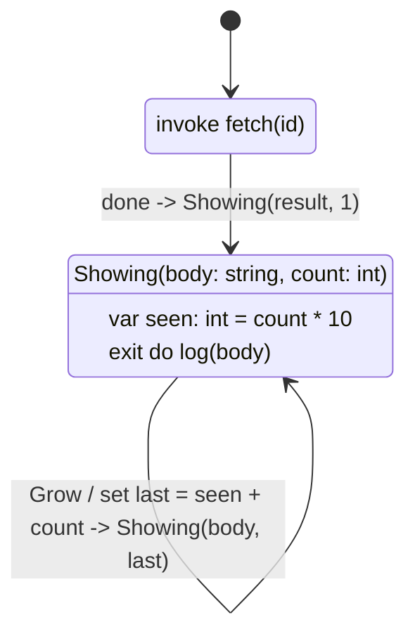
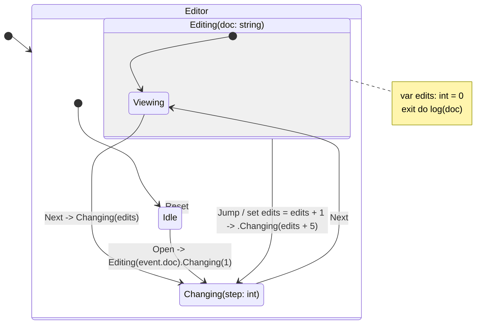
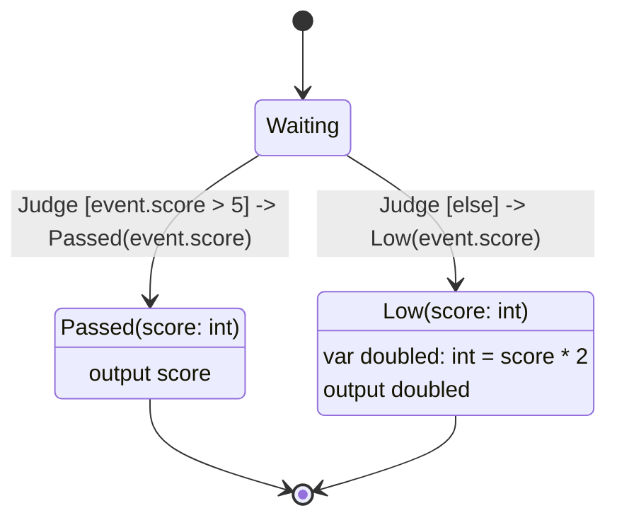
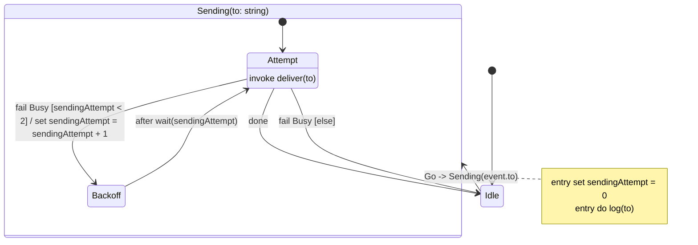
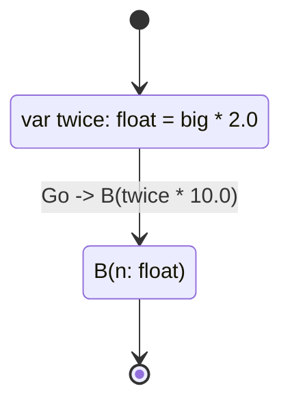
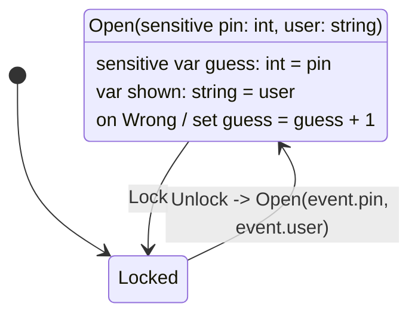

## Counter

`spec/conformance/charts/locals.road:15`

```text
State variables: bound each time their state is entered, in order, an initial value
reading the ones before it and a child's reading its parent's.
```



## Fetch

`spec/conformance/charts/locals.road:42`

```text
State parameters: arguments from `result`, from the left state's own locals on
re-entry, and from what the transition assigned.
```



## Editor

`spec/conformance/charts/locals.road:65`

```text
A target through a state with parameters, a transition inside it that keeps it, an
internal one, and one in the machine body.
```



## Verdict

`spec/conformance/charts/locals.road:89`

```text
A final state's parameter and variable as the machine's output.
```



## Courier

`spec/conformance/charts/locals.road:110`

```text
A retry in a state with parameters: its locals live through every attempt.
```



## Overflow

`spec/conformance/charts/locals.road:127`

```text
An argument that overflows: the step is atomic and the run ends with a defect.
```



## Vault

`spec/conformance/charts/locals.road:141`

```text
Sensitive parameters and variables are redacted in `set` records.
```


