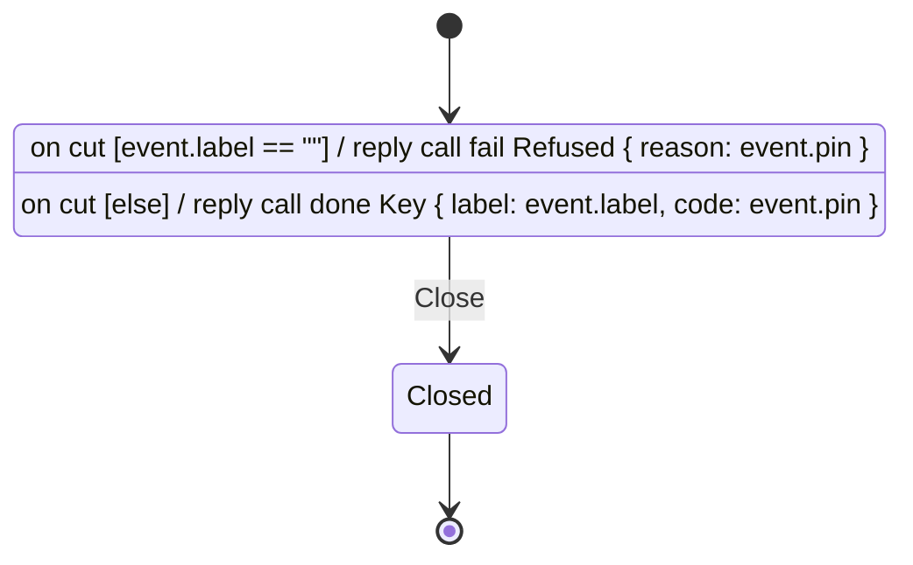
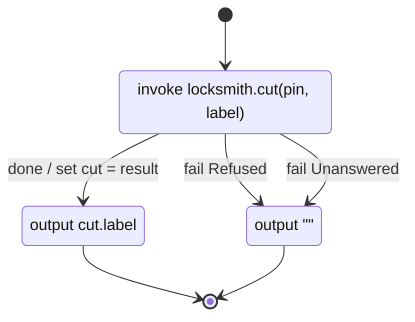

## Locksmith

`spec/conformance/charts/locksmith.road:13`

```text
Cuts keys for its callers.
```



## Client

`spec/conformance/charts/locksmith.road:33`

```text
Ask the locksmith for a key; give its label, or "" if it refused.
```


