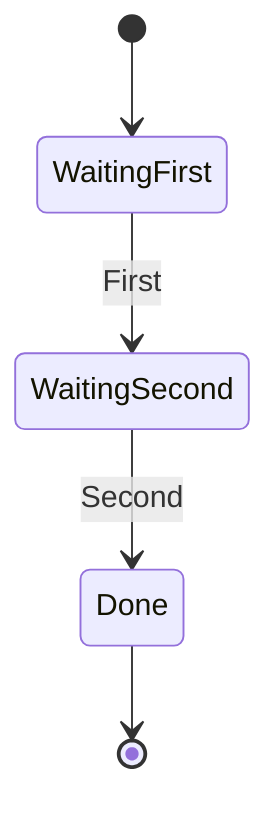
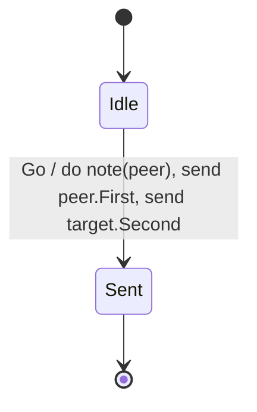

## Receiver

`spec/conformance/charts/pair.road:8`

```text
Must get First before Second.
```



## Sender

`spec/conformance/charts/pair.road:22`

```text
Sends First, then Second, in one transition, to the same peer named two ways.
```


