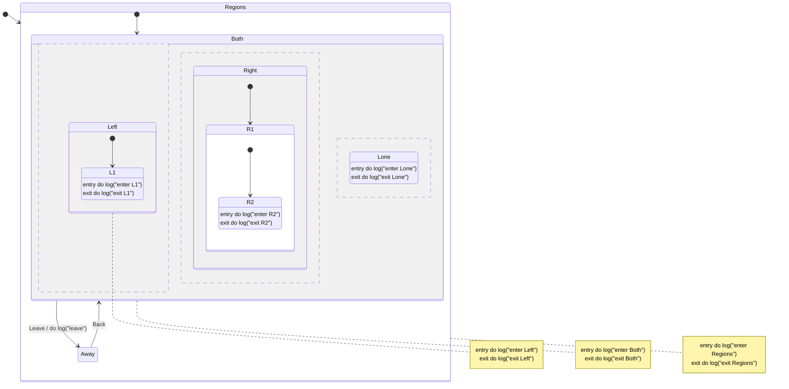
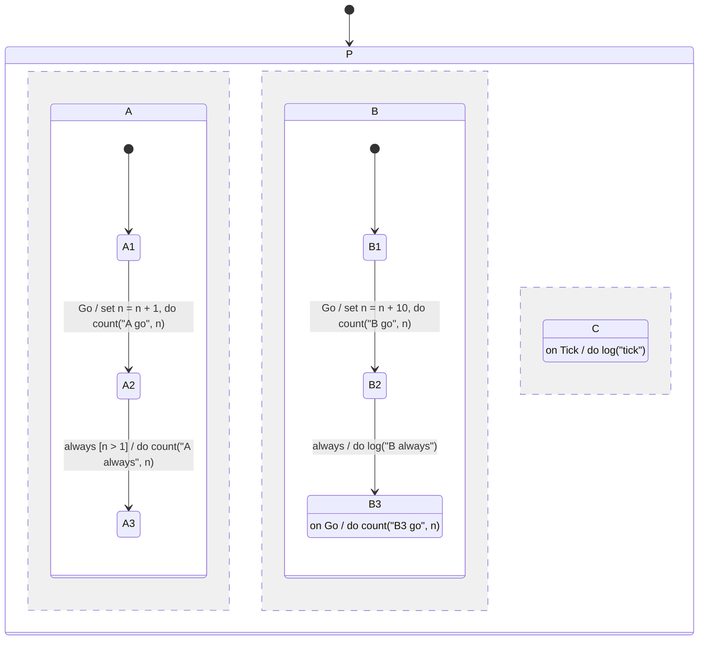
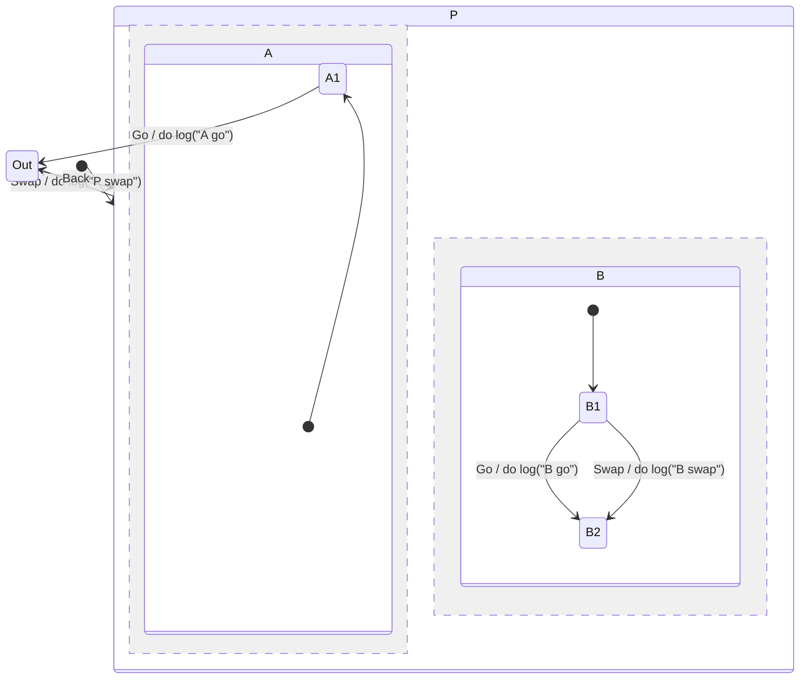
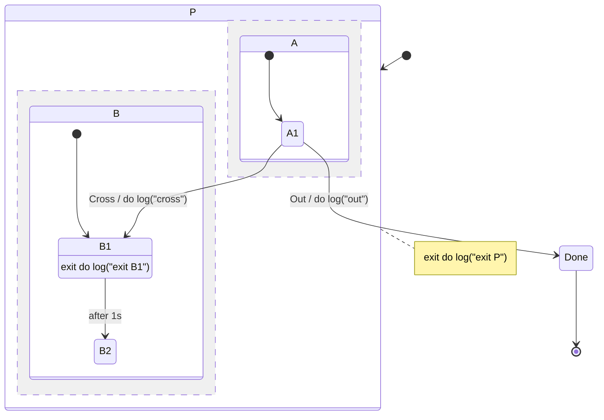
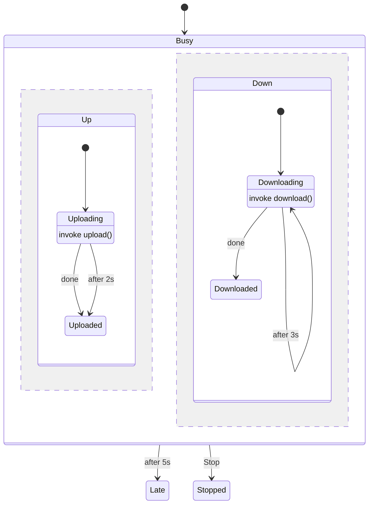

## Regions

`spec/conformance/charts/parallel.road:11`

```text
Enters and exits three regions of different kinds, in document order.
```



## Fork

`spec/conformance/charts/parallel.road:62`

```text
One event taken in two regions, and `always` transitions in two regions
taken in one microstep.
```



## Clash

`spec/conformance/charts/parallel.road:96`

```text
Two regions' transitions for one event that would exit the same state.
```



## Escape

`spec/conformance/charts/parallel.road:129`

```text
Transitions from inside a region: into another region, and out of the
parallel state.
```



## Finish

`spec/conformance/charts/parallel.road:164`

```text
A parallel state completes when every region is in a final state.
```

```mermaid
stateDiagram-v2
  state Work {
    state "Left" as Work_Left
    state Work_Left {
      state "L1" as Work_Left_L1
      state "L2" as Work_Left_L2
      [*] --> Work_Left_L1
      Work_Left_L1 --> Work_Left_L2: A
      Work_Left_L2 --> [*]
    }
    note right of Work_Left
      done / do log("left done")
    end note
    --
    state "Mid" as Work_Mid
    --
    state "Right" as Work_Right
    state Work_Right {
      state "R1" as Work_Right_R1
      state "R2" as Work_Right_R2
      [*] --> Work_Right_R1
      Work_Right_R1 --> Work_Right_R2: B
      Work_Right_R2 --> [*]
    }
    Work_Mid --> [*]
  }
  Over: output "over"
  [*] --> Work
  Work --> Over: done / do log("work done")
  Over --> [*]
```

## Jobs

`spec/conformance/charts/parallel.road:198`

```text
Invokes and timers in two regions and on the parallel state itself.
```



## Shell

`spec/conformance/charts/parallel.road:243`

```text
A parallel state inside a compound state, left by the compound state's
transition.
```

```mermaid
stateDiagram-v2
  state Outer {
    state "Split" as Outer_Split
    state Outer_Split {
      state "X" as Outer_Split_X
      Outer_Split_X: exit do log("exit X")
      --
      state "Y" as Outer_Split_Y
      state Outer_Split_Y {
        state "Y1" as Outer_Split_Y_Y1
        Outer_Split_Y_Y1: exit do log("exit Y1")
        state "Y2" as Outer_Split_Y_Y2
        [*] --> Outer_Split_Y_Y1
        Outer_Split_Y_Y1 --> Outer_Split_Y_Y2: after 1s
      }
    }
    note right of Outer_Split
      exit do log("exit Split")
    end note
    [*] --> Outer_Split
  }
  note right of Outer
    exit do log("exit Outer")
  end note
  [*] --> Outer
  Outer --> Gone: Leave / do log("leave")
```
