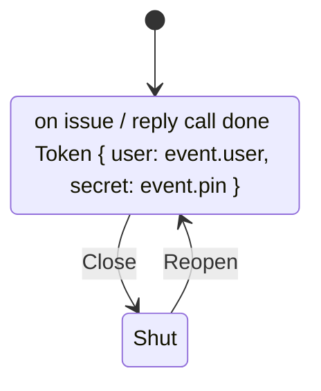
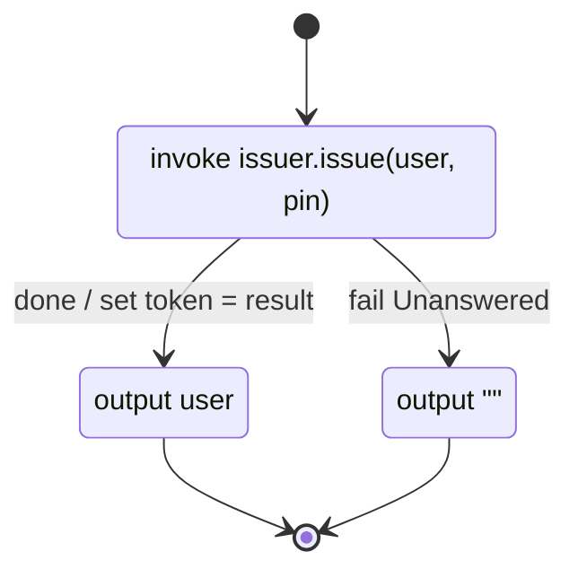

## Issuer

`spec/conformance/charts/redact-call.road:11`

```text
Issues tokens while it is open; strict, so a call while closed is a defect.
```



## Client

`spec/conformance/charts/redact-call.road:30`

```text
Asks the issuer for a token; gives the user it was issued to, or "".
```


