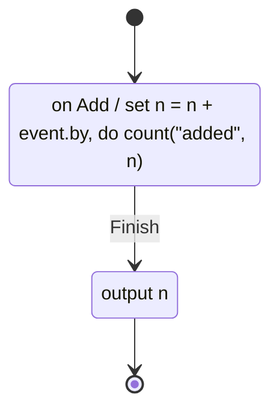
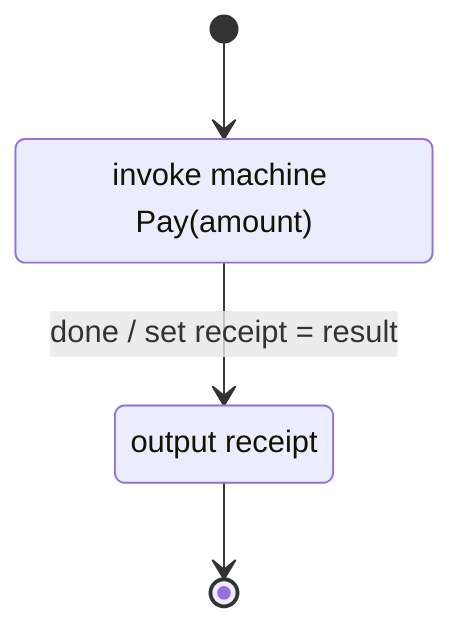
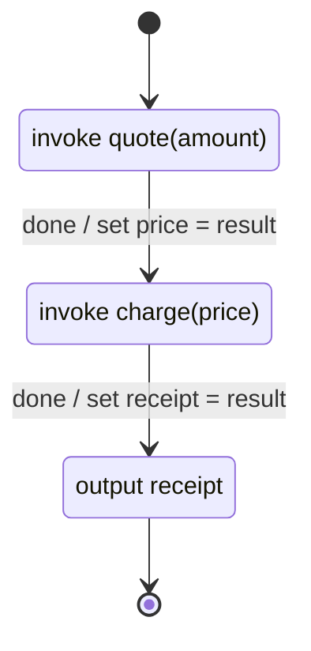
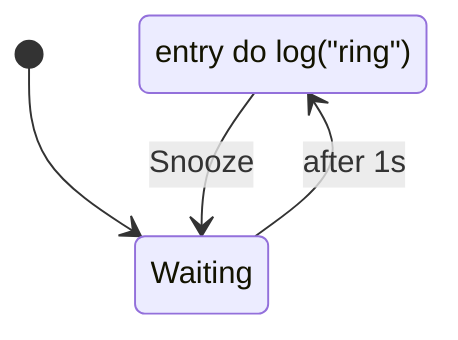
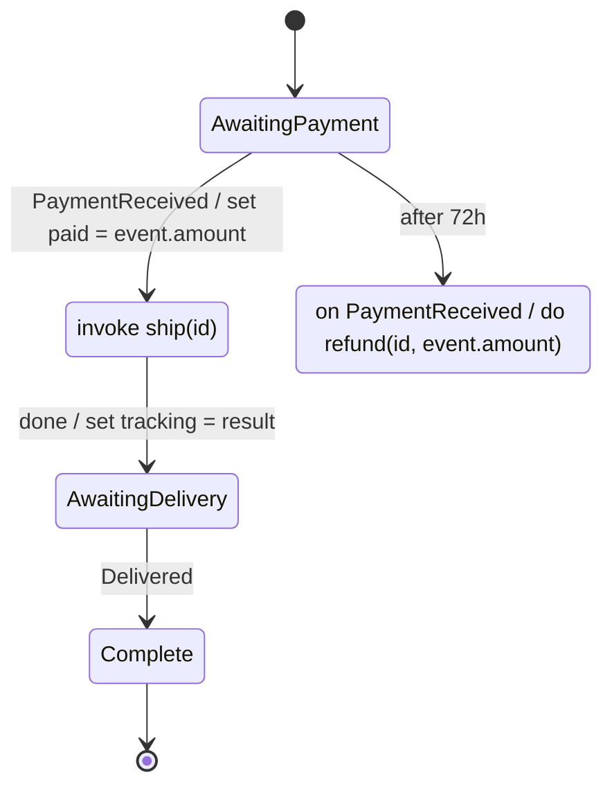

## Counter

`spec/conformance/charts/saved.road:13`

```text
A counter that waits for events in a state with no work.
```



## Shop

`spec/conformance/charts/saved.road:30`

```text
Pays through a child machine.
```



## Pay

`spec/conformance/charts/saved.road:45`

```text
Quotes a price, then charges it.
```



## Reminder

`spec/conformance/charts/saved.road:67`

```text
Rings a second after it starts waiting.
```



## Order

`spec/conformance/charts/saved.road:83`

```text
An order kept as a snapshot between requests: it waits three days for
payment, ships, and waits for delivery.
```


