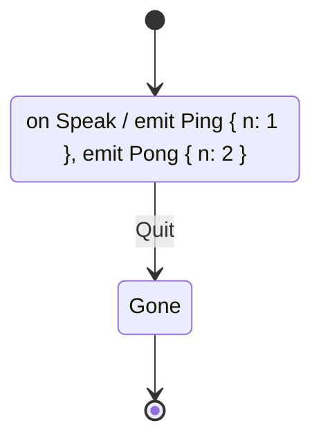
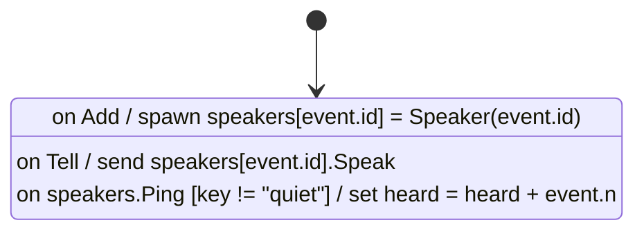
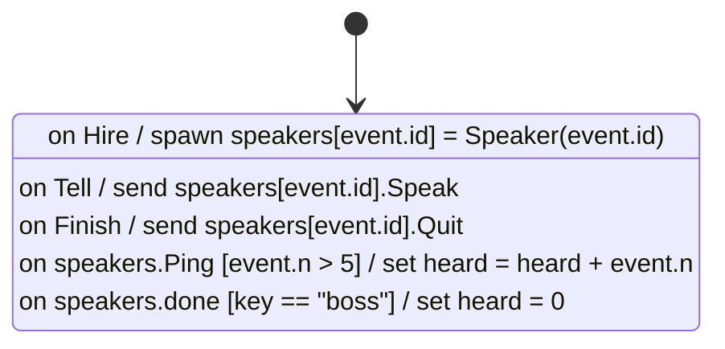

## Speaker

`spec/conformance/charts/speakers.road:7`

```text
Says two things when told to, and ends when told to quit.
```



## Listener

`spec/conformance/charts/speakers.road:24`

```text
Hears its speakers' `Ping`, from every key but "quiet", and never their `Pong`.
```



## Foreman

`spec/conformance/charts/speakers.road:43`

```text
Strict, with spawned children: what they emit or end with that it does not take is
dropped, and only its own events can be `unhandled`.
```


