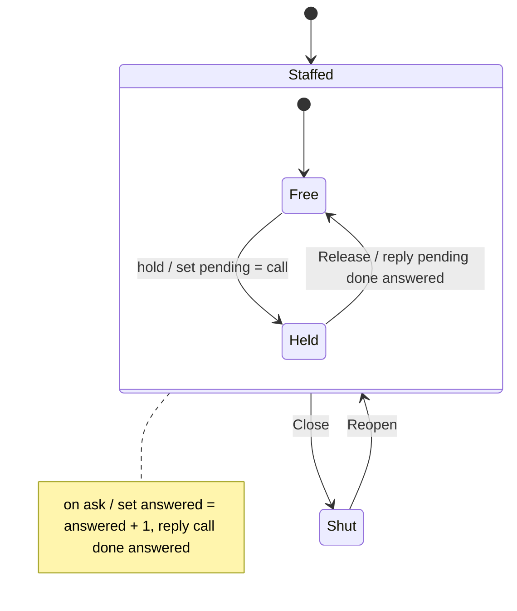
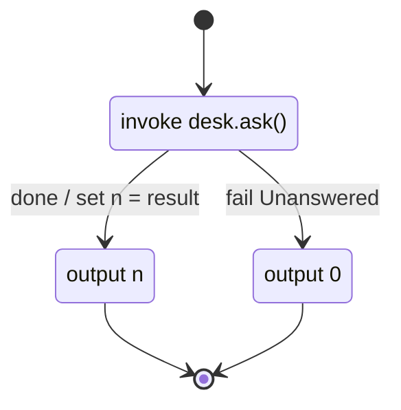
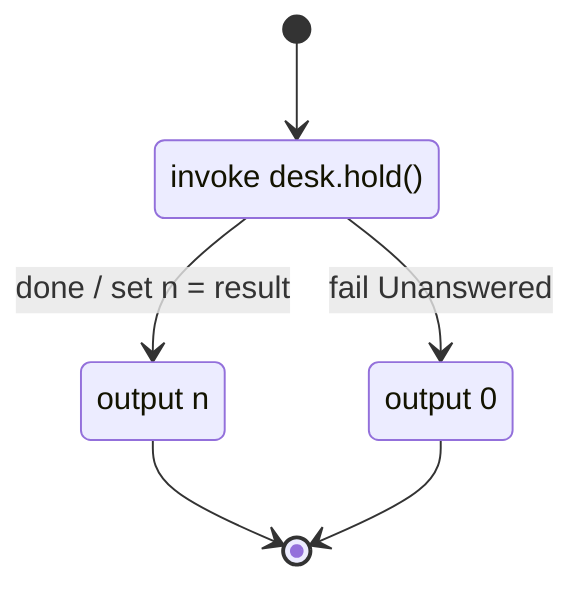

## Desk

`spec/conformance/charts/strict-calls.road:6`

```text
A help desk that answers questions while it is open.
```



## Asker

`spec/conformance/charts/strict-calls.road:37`

```text
Ask the desk a question; 0 if it does not answer.
```



## Holder

`spec/conformance/charts/strict-calls.road:54`

```text
Hold a place with the desk; 0 if it does not answer.
```


