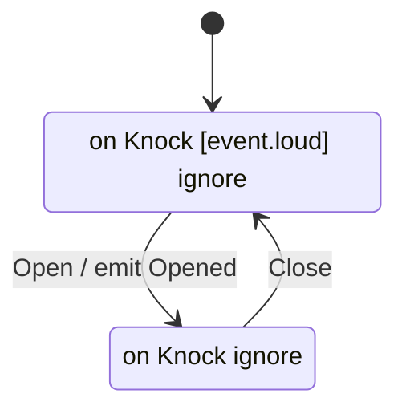
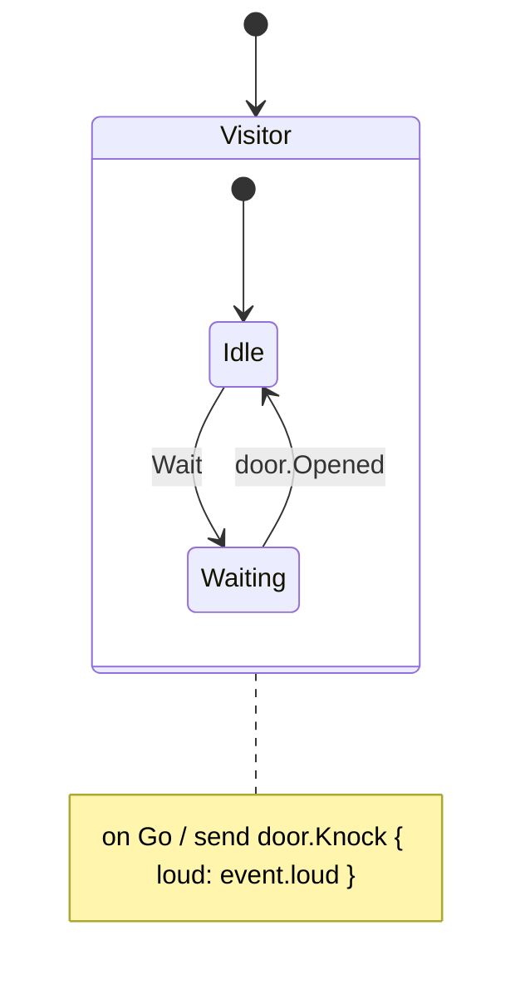

## Door

`spec/conformance/charts/strict-messages.road:6`

```text
Takes a loud knock while shut and any knock while ajar; tells its visitors when it opens.
```



## Visitor

`spec/conformance/charts/strict-messages.road:27`

```text
Knocks on its door when told to. Hears `Opened` only while it waits for it.
```


