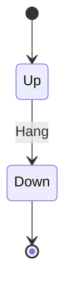
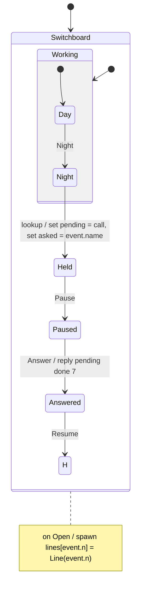
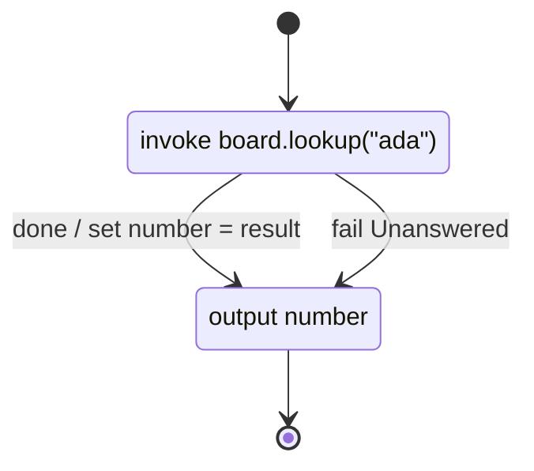

## Line

`spec/conformance/charts/switchboard.road:7`

```text
One open line, until it is hung up.
```



## Switchboard

`spec/conformance/charts/switchboard.road:19`

```text
Opens lines, holds a lookup taken at night, and pauses to answer it, coming back to the
state it was in.
```



## Caller

`spec/conformance/charts/switchboard.road:52`

```text
Looks a name up.
```


