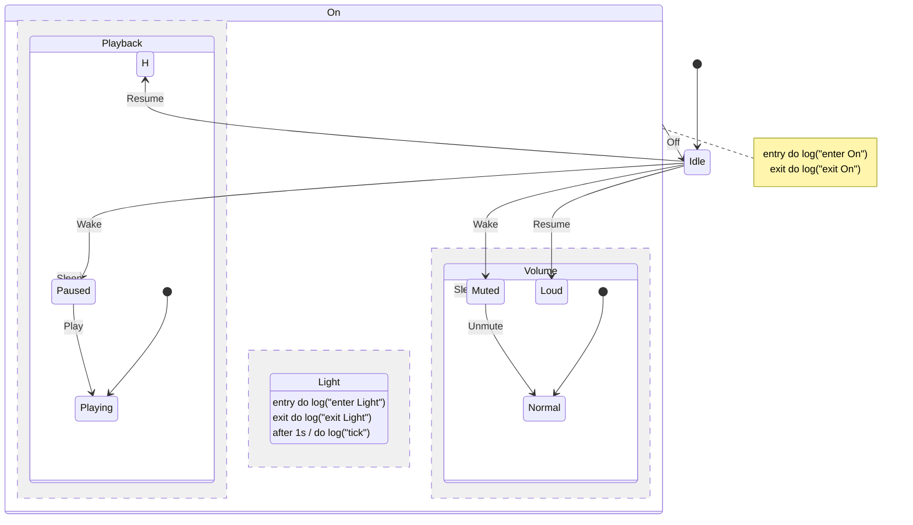

## Player

`spec/conformance/charts/targets.road:9`

```text
Several targets enter several regions of a parallel state at once, the other regions by
default entry; written with dots in the parallel state, they exit and enter only those
regions.
```


