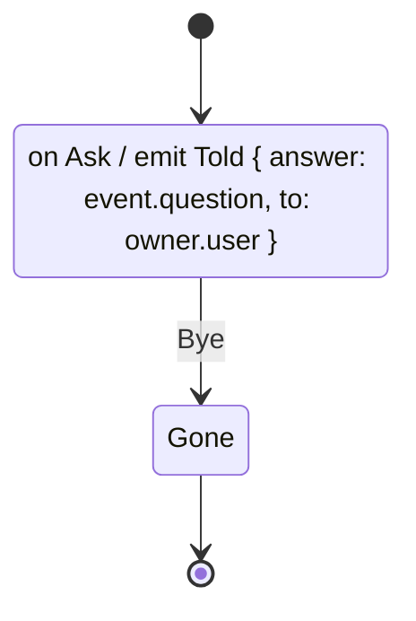
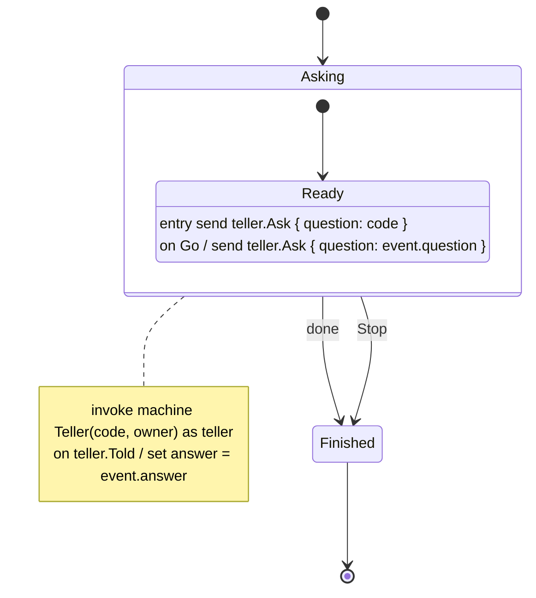
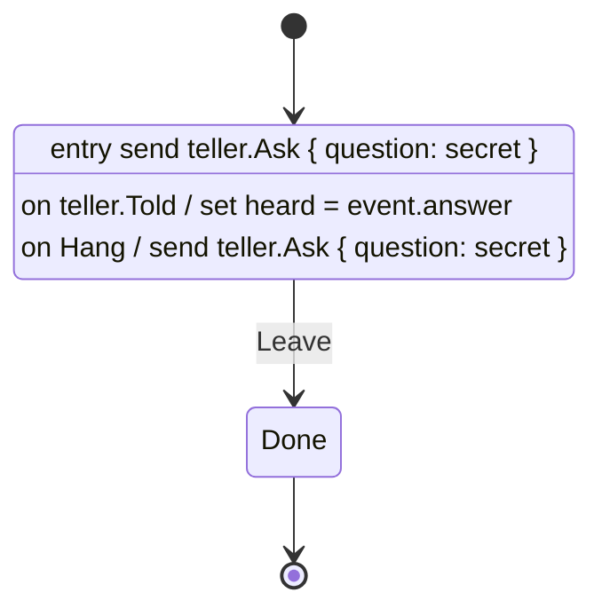

## Teller

`spec/conformance/charts/teller.road:7`

```text
Answers questions from whoever invoked it with what it was asked.
```



## Keeper

`spec/conformance/charts/teller.road:23`

```text
Invokes a Teller and asks it a question: before it runs, and once it does.
```



## Caller

`spec/conformance/charts/teller.road:48`

```text
Asks a Teller it holds a `ref` to, and keeps the answer.
```


