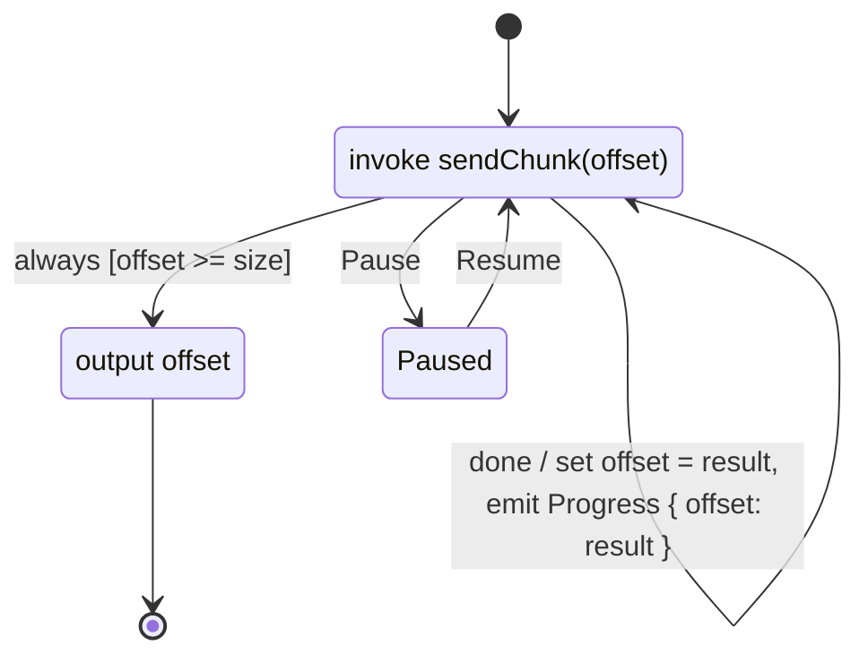
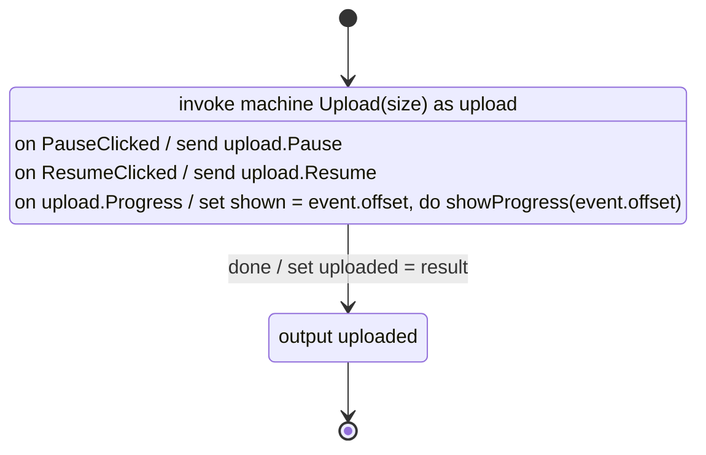
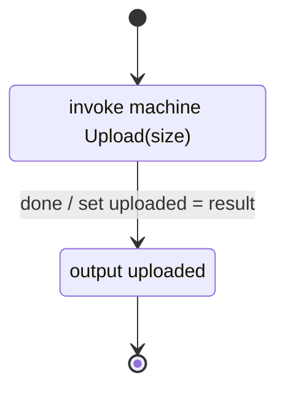
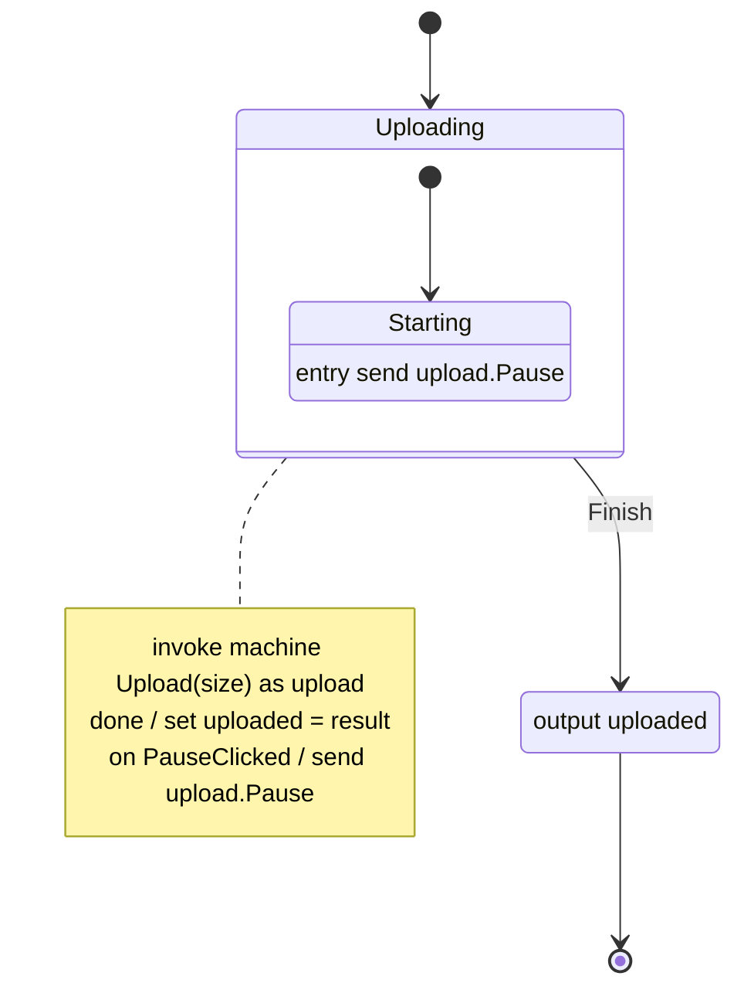

## Upload

`spec/conformance/charts/upload.road:11`

```text
Sends chunks until `size` bytes are stored, reporting each one. Can be paused.
```



## Publish

`spec/conformance/charts/upload.road:34`

```text
Uploads, pausing and resuming the child when asked, and shows its progress.
```



## Quiet

`spec/conformance/charts/upload.road:56`

```text
Invokes Upload without `as`, so it receives nothing the child emits.
```



## Eager

`spec/conformance/charts/upload.road:71`

```text
Sends to its child before the child has started, and after its outcome was taken.
```


