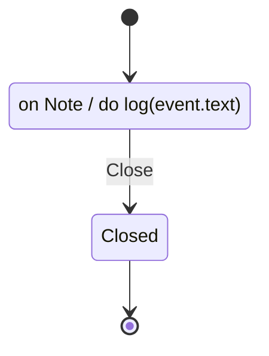
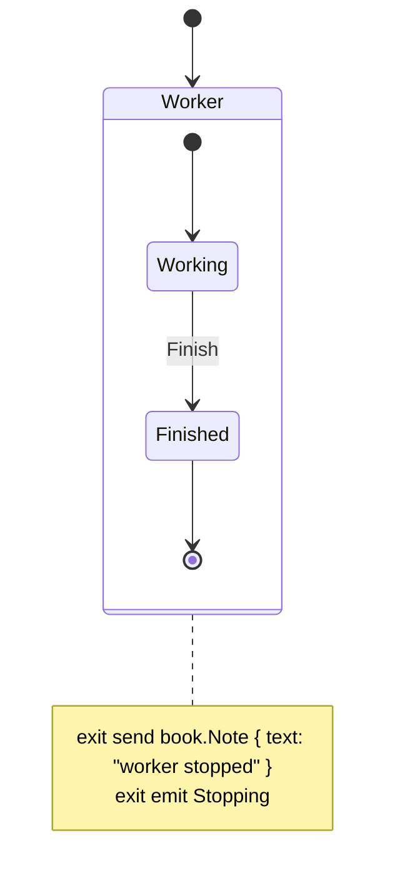
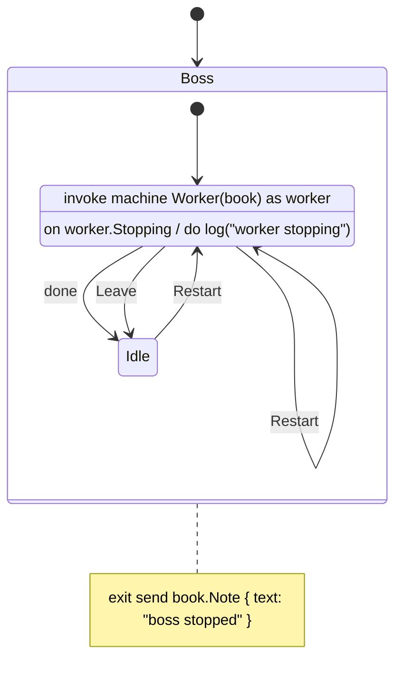

## Logbook

`spec/conformance/charts/workers.road:8`

```text
Takes notes from every machine that holds a reference to it.
```



## Worker

`spec/conformance/charts/workers.road:23`

```text
Works until it is cancelled, then says so to the logbook and to its parent.
```



## Boss

`spec/conformance/charts/workers.road:37`

```text
Watches a Worker, which it can restart or leave.
```


